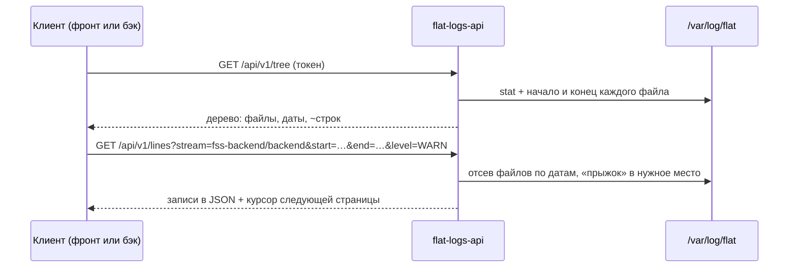

# Логи `/var/log/flat` через API — базовый анализ

[← к оглавлению agent_2](../README.md) · подробно: [02 — Технический анализ](02-design.md)

> Статус: аналитика, «мозговой штурм». Кода нет, пакет не выбран.
> Названия `flat-logs-api` (служба) и `flat-logs` (пользователь) — рабочие.

## Зачем

Нужен API, который по возможностям похож на VictoriaLogs, но работает прямо
с файлами в `/var/log/flat`: клиент с токеном спрашивает, какие логи есть на
сервере, и получает нужные строки в JSON. Клиент — любой: внешний или
внутренний фронт, внешний или внутренний бэкенд.

## Как этим пользуются

1. **Что есть на сервере?** Клиент не знает, какие продукты стоят на хосте,
   поэтому первый запрос — вся иерархия `/var/log/flat`:
   `GET /api/v1/tree`. В ответе — папки и файлы, у каждого файла размер,
   первая и последняя дата, примерное число строк.
2. **Конкретная служба.** `GET /api/v1/tree?path=fss-backend` — то же для
   одной папки.
3. **Точные сведения о файле** (по желанию): `GET /api/v1/info?path=…` —
   точное число строк и счётчики уровней.
4. **Строки:**
   - `from=100` — с 100-й строки до конца;
   - `from=100&to=200` — диапазон строк;
   - `start=…&end=…` — за период;
   - `start=…&end=…&level=WARN` — уровень за период;
   - без параметров — весь файл, по страницам.

## Главная идея: не индексировать, а «прыгать», как `flat_check_2.sh`

Фоновую индексацию всех логов не делаем. Вместо этого — тот же приём, что
уже работает в сборщике логов `flat_check_2.sh`:

- **Дерево.** Для каждого файла читаются только начало и конец
  (десятки–сотни КБ, независимо от размера файла). Отсюда первая и последняя
  дата. Число строк — **оценка** по средней длине строки; точное число —
  **по запросу** конкретного файла.
- **Поиск по времени.** Файлы, чей период не пересекается с запросом,
  не открываются вовсе. В нужном файле место угадывается пропорцией и
  уточняется несколькими пробами.

Пример. Файл с 31.12.2026 22:00:00 по 01.01.2027 02:48:53 (4 ч 49 мин),
запрос с 01.01.2027 01:00:00 по 02.01.2027 12:00:00:

1. Периоды пересекаются — файл нужен.
2. Начало запроса — через 3 ч от начала файла, это ≈ 62 % его размера.
   Конец запроса позже конца файла — читаем до конца.
3. Смотрим строку на 62 %: там 00:57 — сдвигаемся чуть вперёд; 01:05 — назад.
4. Нашли — читаем подряд примерно последние 38 % файла, фильтруем по уровню.

Ротированные архивы (`.gz`) так не «прыгают»: их распаковывают потоком, но
архивы вне периода отсеиваются без распаковки.

## Что уже решено

| Вопрос | Решение |
|---|---|
| Индексация | без фонового индекса; начало и конец файла, как `flat_check_2.sh` |
| Число строк | в дереве — оценка; точно — по запросу файла |
| Номер строки в ответе по времени | по умолчанию байтовая позиция `offset`; номер — по флагу `line_numbers=1` |
| Формат строк | Log4j / Python logging: время — уровень — компонент — сообщение; уровня может не быть |
| Уровни | `INFO`, `WARN`, `ERROR` (+ `DEBUG`, `TRACE`, `FATAL`) |
| Симлинки в `/var/log/flat` | переходим; нет прав — ошибка `permission_denied` |
| Владелец логов | учётка продукта (`flat-user` и аналоги) |
| Клиенты | любые, у кого есть токен |
| Ротированные файлы | обрабатываются |
| Пакет | не выбран — аналитика |

## Три варианта

| | A. bash + awk | B. Go-служба | C. VictoriaLogs + шлюз |
|---|---|---|---|
| Основа | логика `flat_check_2.sh` и подход flat-check agent | подход agent 2: статический бинарник, только чтение | экосистема VictoriaMetrics из agent 2 |
| Суть | скрипт на каждое HTTP-соединение (systemd socket) | одна служба: дерево, строки, время, уровни | логи копируются в базу VictoriaLogs; для дерева и строк — шлюз из B |
| Сильное | быстрый прототип, проверенная логика | безопасность, скорость, тестируемость | полнотекстовый поиск по всем логам, графики |
| Слабое | HTTP, JSON и проверка путей на bash; третья копия кода `flat_check_2.sh` | свой код на Go | тяжело: копия логов на диске, нет номеров строк, всё равно нужен шлюз |

## Рекомендация

**Вариант B.** Алгоритм тот же, что в `flat_check_2.sh`, переписанный на Go;
пути проверяются безопасно, служба без состояния и без фоновой нагрузки.
Контракт API делаем таким, чтобы позже за ним можно было поставить
VictoriaLogs (вариант C), если понадобится поиск сразу по всем логам.
Вариант A — только как одноразовый прототип для согласования API с фронтом.

## Что осталось решить

- Нужна ли в дереве группировка «продукт → служба» (папки названы по пакетам).
- Модель прав: отдельный пользователь в группе продукта или запуск от учётки
  продукта — зависит от прав на файлы логов на реальных хостах.
- TLS в самой службе или nginx перед ней.
- Кто выпускает токены и как их отзывать.
- Список разрешённых каталогов для целей симлинков.

Подробности, ограничения и техническое описание —
в [02 — Технический анализ](02-design.md).
