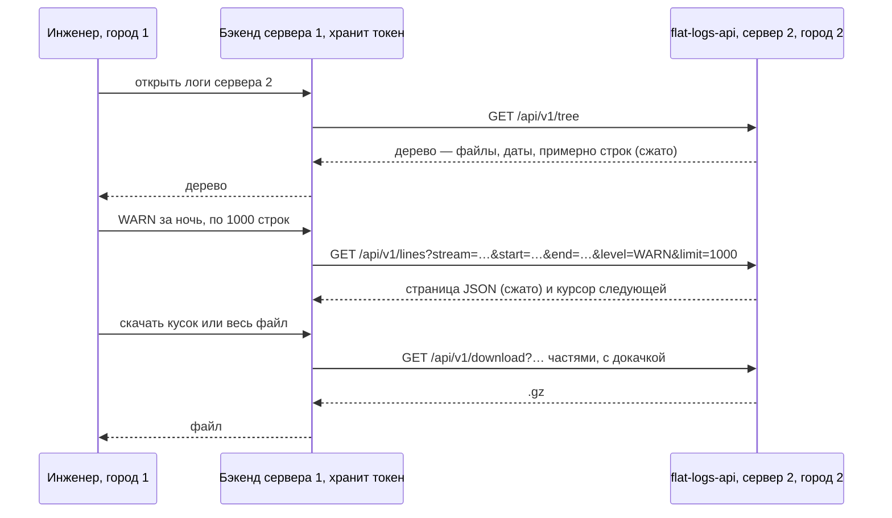

# Логи `/var/log/flat` через API — базовый анализ

[← к оглавлению agent_2](../README.md) · подробно: [02 — Технический анализ](02-design.md)

> Статус: аналитика. **Решение — отдельная служба на Go (вариант B).**
> Вариант на bash (A) отклонён, VictoriaLogs (C) — резерв на будущее.
> **Предложение:** лёгкий фоновый индекс уровней 1–3 поверх «прыжков».
> Кода нет, пакет не выбран. Названия `flat-logs-api` (служба) и
> `flat-logs` (пользователь) — рабочие.

## Зачем

Нужен API, который по возможностям похож на VictoriaLogs, но работает прямо
с файлами в `/var/log/flat`: клиент с токеном спрашивает, какие логи есть на
сервере, и получает нужные строки в JSON или скачивает файл целиком или
кусок. Клиент — любой: внешний или внутренний фронт, внешний или внутренний
бэкенд.

Типичный случай: инженер в городе 1 смотрит логи службы на сервере в
городе 2, а канал до города 2 слабый — спутник, другая страна. Поэтому
данные идут **страницами и сжатыми**, а большие куски — **скачиванием
с докачкой**.

## Как этим пользуются

1. **Что есть на сервере?** Клиент не знает, какие продукты стоят на хосте,
   поэтому первый запрос — вся иерархия `/var/log/flat`: папки и файлы, у
   каждого файла размер, первая и последняя дата, примерное число строк.
2. **Конкретная служба** — то же для одной папки.
3. **Точные сведения о файле** (по запросу) — точное число строк, счётчики
   уровней.
4. **Строки страницами** по 100, 1000 или 10 000: с N-й строки, диапазон
   строк, за период, уровень за период, весь файл.
5. **Скачать** весь файл, диапазон строк, байтов или период — сжатым
   архивом, с возможностью докачки.

## Главная идея: не индексировать, а «прыгать», как `flat_check_2.sh`

Фоновую индексацию всех логов не делаем. Вместо этого — тот же приём, что
уже работает в сборщике логов `flat_check_2.sh`:

- **Дерево.** Для каждого файла читаются только начало и конец
  (десятки–сотни КБ, независимо от размера файла). Отсюда первая и последняя
  дата. Число строк — **оценка** по средней длине строки; точное число —
  **по запросу** конкретного файла.
- **Поиск по времени.** Файлы, чей период не пересекается с запросом,
  не открываются вовсе. В нужном файле место угадывается пропорцией и
  уточняется несколькими пробами.

Пример. Файл с 31.12.2026 22:00:00 по 01.01.2027 02:48:53 (4 ч 49 мин),
запрос с 01.01.2027 01:00:00 по 02.01.2027 12:00:00:

1. Периоды пересекаются — файл нужен.
2. Начало запроса — через 3 ч от начала файла, это ≈ 62 % его размера.
   Конец запроса позже конца файла — читаем до конца.
3. Смотрим строку на 62 %: там 00:57 — сдвигаемся чуть вперёд; 01:05 — назад.
4. Нашли — читаем подряд примерно последние 38 % файла, фильтруем по уровню.

Ротированные архивы (`.gz`) так не «прыгают»: их распаковывают потоком, но
архивы вне периода отсеиваются без распаковки.

## Предложение: лёгкий индекс поверх «прыжков»

Чтобы служба заранее знала, что лежит в логах, в фоне строится **лёгкий
индекс**, включая архивы. Индексируются не слова целиком, а «карта блоков»:
файл делится на блоки примерно по 1 МБ, у каждого — короткая сводка.

| Уровень | Что хранится | Что даёт |
|---|---|---|
| 1 | точные сведения о файле: строки, даты, число строк по уровням | точное дерево, `/info` мгновенно |
| 2 | на каждый блок ~1 МБ: номер первой строки, наименьшее и наибольшее время, уровни; счётчики по часам | переход к строке и времени без проб, номера строк всегда, пропуск блоков без `ERROR`, графики «когда сыпались ошибки» |
| 3 | на блок — фильтр «какие слова здесь могут быть» | поиск Call-ID, номера, ID по логам: читаются только подходящие блоки |

- **Только ускоритель.** Что не проиндексировано (новый файл, индекс ещё
  строится или выключен) — ищется как сейчас, «прыжками». Ответы одинаковые.
- **Нагрузка.**
  - Первичное построение — один проход по всем логам: по оценке минуты–десятки
    минут, в фоне, с самым низким приоритетом.
  - Дальше — только дописанное, почти бесплатно.
  - Уровни 1–2 занимают около 0,01 % объёма логов. Уровень 3 — проценты,
    поэтому только для выбранных потоков и в пределах бюджета.
- **Отдельный процесс-индексатор**: можно выключить, остановить, ограничить —
  API работает и без него.

## Большие логи и слабый канал

| Объём логов службы | Как смотреть |
|---|---|
| до 10–15 МБ | страницами JSON, можно пролистать всё |
| 200–300 МБ | страницами + поиск по времени и уровню; целиком — скачать сжатым |
| 1–2 ГБ | страницами и поиском; скачать — нужный кусок или целиком частями с докачкой |

- **Сжатие всегда.** Ответы сжимаются (gzip), если клиент это поддерживает:
  текст логов обычно сжимается в несколько раз.
- **Страницы.** Клиент сам выбирает размер: 100, 1000, 10 000 строк. Если
  страница получается слишком большой (длинные строки), служба отдаёт
  меньше и курсор на продолжение.
- **Скачивание:**
  - уже сжатые ротации (`.gz`) отдаются как есть — без лишней работы на
    сервере, с докачкой при обрыве;
  - живой файл, диапазон строк или период сжимаются «на лету»;
  - большие выгрузки — **частями** (например, по 16 МБ исходного текста):
    оборвалась часть — перекачивается только она; склеенные части — обычный
    `.gz`.
- **Не забить канал.** Скорость выгрузки ограничивается, чтобы скачивание
  лога не мешало трафику самого продукта (например, голосу через спутник).
- **Без временных файлов** на сервере продукта: всё отдаётся потоком.

## Что уже решено

| Вопрос | Решение |
|---|---|
| Реализация | отдельная служба на Go (B); bash (A) отклонён; VictoriaLogs (C) — резерв |
| Индексация | предложение: лёгкий фоновый индекс уровней 1–3; всё непроиндексированное — по началу и концу файла и «прыжками», как `flat_check_2.sh` |
| Число строк | с индексом — точно; без него в дереве — оценка, точно — по запросу файла |
| Номер строки в ответе по времени | по умолчанию байтовая позиция `offset`; номер — по флагу `line_numbers=1` |
| Формат строк | Log4j / Python logging: время — уровень — компонент — сообщение; уровня может не быть |
| Уровни | `INFO`, `WARN`, `ERROR` (+ `DEBUG`, `TRACE`, `FATAL`) |
| Симлинки в `/var/log/flat` | переходим; нет прав — ошибка `permission_denied` |
| Владелец логов | учётка продукта (`flat-user` и аналоги) |
| Клиенты | любые, у кого есть токен |
| Ротированные файлы | обрабатываются |
| Страницы | 100 / 1000 / 10 000 строк на выбор клиента |
| Большие объёмы | сжатие ответов; скачивание целиком или куска, частями, с докачкой |
| Пакет | не выбран — аналитика |

## Резерв: VictoriaLogs

Если понадобится поиск сразу по всем логам, по любому тексту, с графиками
частоты ошибок — за тем же API можно поставить VictoriaLogs. Клиенты при
этом не меняются: служба остаётся шлюзом (токены, дерево, номера строк,
скачивание). Цена — копия логов в базе на диске сервера и два новых
компонента. Пока не делаем.

## Что осталось решить

- Нужна ли в дереве группировка «продукт → служба» (папки названы по пакетам).
- Модель прав: отдельный пользователь в группе продукта или запуск от учётки
  продукта — зависит от прав на файлы логов на реальных хостах.
- TLS в самой службе или nginx перед ней.
- Кто выпускает токены и как их отзывать; кому разрешено скачивание.
- Предел скорости скачивания по умолчанию.
- Ходит ли браузер инженера к серверу 2 сам или только через бэкенд
  сервера 1.
- Сколько диска отдать индексу и для каких потоков нужен поиск по тексту
  (уровень 3).

Подробности, ограничения и техническое описание —
в [02 — Технический анализ](02-design.md).
