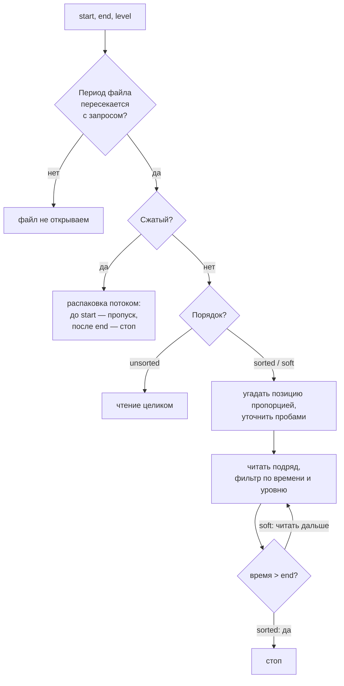
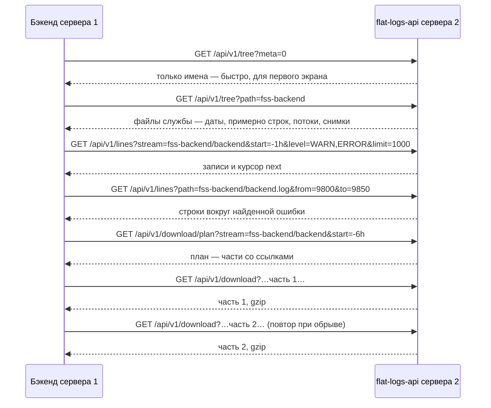
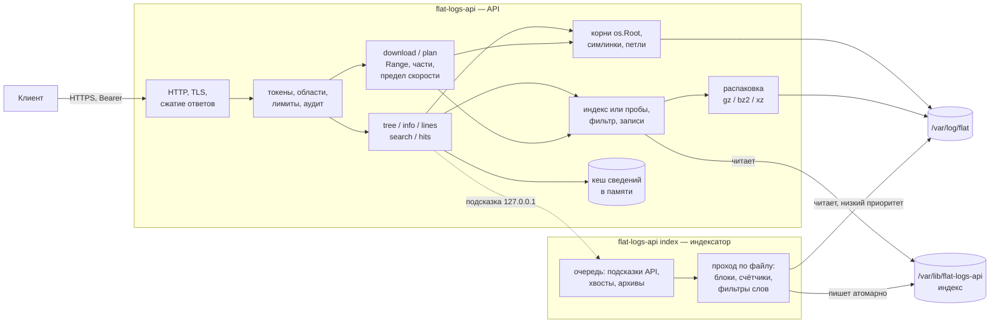
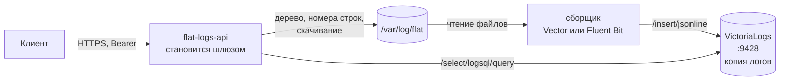

# Логи `/var/log/flat` через API — технический анализ

[← к оглавлению agent_2](../README.md) · коротко: [01 — Базовый анализ](01-brainstorm.md)

> Статус: аналитика. **Решение — отдельная служба на Go (вариант B).**
> Вариант на bash (A) отклонён. VictoriaLogs (C) — резерв
> ([10](#10-резерв-victorialogs)). Кода нет, пакет не выбран.
> **Предложение:** лёгкий индекс уровней 1–3 — ускоритель поверх проб, с
> откатом на них для всего непроиндексированного
> ([4.12](#412-лёгкий-индекс-уровни-13)).
> Названия `flat-logs-api` (служба), `flat-logs` (пользователь), порт
> `8431`, пути `/etc/flat-logs-api/`, `/opt/flat/flat-logs-api/` и
> `/var/lib/flat-logs-api/` — рабочие, до решения по пакету.

## Содержание

1. [Цель и рамки](#1-цель-и-рамки)
2. [Принятые решения](#2-принятые-решения)
3. [Исходные данные](#3-исходные-данные)
4. [Алгоритмы](#4-алгоритмы)
5. [Передача данных: страницы, сжатие, скачивание](#5-передача-данных-страницы-сжатие-скачивание)
6. [API](#6-api)
7. [Безопасность](#7-безопасность)
8. [Ресурсы и лимиты](#8-ресурсы-и-лимиты)
9. [Реализация](#9-реализация)
10. [Резерв: VictoriaLogs](#10-резерв-victorialogs)
11. [Ограничения и нюансы](#11-ограничения-и-нюансы)
12. [Проверка](#12-проверка)
13. [Открытые вопросы](#13-открытые-вопросы)
14. [Ссылки на код](#14-ссылки-на-код)

---

## 1. Цель и рамки

API для анализа логов в `/var/log/flat`, по возможностям похожее на
VictoriaLogs, но работающее прямо с файлами. Клиент с токеном получает
иерархию каталогов и файлов со сведениями о них, затем — строки по условиям
или файл для скачивания. Веб-интерфейс строит по этим ответам дерево,
просмотр записей и кнопки скачивания.

Основной сценарий эксплуатации — **удалённый**: инженер в городе 1 смотрит
логи службы на сервере в городе 2, канал до которого может быть слабым
(спутник, другая страна).

**Входит:**

- дерево `/var/log/flat` со сведениями о файлах;
- строки по номерам, по периоду, по уровню за период, весь файл —
  страницами;
- скачивание файла целиком или куска — сжатым, частями, с докачкой;
- ротированные и сжатые файлы;
- доступ по токену, только чтение, только `/var/log/flat` и симлинки из него.

**Не входит (сейчас):**

- полноценный полнотекстовый поиск (фразы, регулярные выражения, общая
  сортировка по времени между потоками) — резерв, VictoriaLogs
  ([10](#10-резерв-victorialogs)). Поиск по словам даёт индекс уровня 3
  ([4.12.5](#4125-уровень-3-поиск-по-словам));
- запись, удаление, ротация логов — API ничего не меняет;
- «живой» хвост (`tail -f`) по WebSocket/SSE — возможное развитие;
- выбор пакета и сборка.

### Соответствие требованиям

| Требование | Как закрыто |
|---|---|
| GET-запрос с API-ключом | заголовок `Authorization: Bearer <токен>` ([7.3](#73-токены)) |
| Проверка ключа и прав | токен → хеш → область доступа по каталогам и право скачивания; 401 / 403 |
| Анализ содержимого `/var/log/flat` | обход по запросу, чтение начала и конца файлов ([4.1](#41-обход-дерева)–[4.3](#43-сведения-о-сжатом-файле)) |
| JSON с иерархией и сведениями о файлах | `GET /api/v1/tree`: размер, первая и последняя дата, число строк (оценка) |
| Количество строк | оценка в дереве, точное — `GET /api/v1/info` |
| Строки с номера до конца | `GET /api/v1/lines?path=…&from=N` |
| Строки в диапазоне | `…&from=100&to=200` |
| Записи за период | `…&start=…&end=…` (по файлу или по потоку ротаций) |
| Уровень за период | `…&start=…&end=…&level=WARN` |
| Все записи файла | `GET /api/v1/lines?path=…` постранично или `GET /api/v1/download?path=…` |
| Не от `root` | отдельный непривилегированный пользователь, ограничения systemd ([7.1](#71-пользователь-и-права), [7.6](#76-systemd)) |
| Только `/var/log/flat` | относительные пути, симлинки только из `/var/log/flat` и по списку корней ([7.2](#72-ограничение-каталогом)) |

Требования, появившиеся в обсуждении:

| Требование | Как закрыто |
|---|---|
| Страницы по 100 / 1000 / 10 000 строк | `limit` с пределом по байтам ([5.3](#53-страницы-json)) |
| Слабый канал между городами и странами | сжатие ответов, курсоры, ограничение скорости ([5.4](#54-сжатие-ответов), [5.7](#57-ограничение-скорости-и-нагрузки)) |
| Скачать весь файл или кусок | `GET /api/v1/download` ([5.5](#55-скачивание)) |
| Большие логи (сотни МБ – ГБ) | скачивание частями с докачкой ([5.6](#56-докачка-и-скачивание-частями)) |
| Служба заранее знает, что есть в логах (точные строки, даты, уровни) | лёгкий фоновый индекс уровней 1–3 с откатом на пробы ([4.12](#412-лёгкий-индекс-уровни-13)) |

---

## 2. Принятые решения

| Вопрос | Решение |
|---|---|
| Реализация | отдельная служба на Go (вариант B). Bash (A) отклонён. VictoriaLogs (C) — резерв |
| Индексация | **предложение:** лёгкий фоновый индекс уровней 1–3 ([4.12](#412-лёгкий-индекс-уровни-13)) как ускоритель. Всё, что не проиндексировано, — как без индекса: сведения из начала и конца файла, поиск по времени «прыжками», как в `flat_check_2.sh` |
| Число строк | для проиндексированных файлов — точное; для остальных в дереве — оценка (`lines_exact: false`), точное — по запросу файла, `GET /api/v1/info` |
| Номер строки в ответе на запрос по времени | для проиндексированных файлов — всегда; для остальных по умолчанию — байтовая позиция `offset`, номер строки — по флагу `line_numbers=1` |
| Формат строк | прикладной лог по образцу Log4j / Python logging: время — уровень — компонент — сообщение; уровень бывает не всегда |
| Симлинки внутри `/var/log/flat` | переходим (туда пишет сам продукт); нет прав — `permission_denied` |
| Владелец логов | учётка продукта: `flat-user` и аналоги |
| Клиенты | любые — внешние и внутренние фронты и бэкенды; критерий один: есть токен |
| Ротированные файлы | обрабатываются, включая сжатые |
| Страницы | 100 / 1000 / 10 000 строк — на выбор клиента |
| Большие объёмы и слабый канал | сжатие ответов; скачивание целиком или куска, частями, с докачкой, с ограничением скорости |
| Временные файлы на сервере продукта | не создаются: всё отдаётся потоком. Единственное, что пишется на диск, — небольшой индекс в `/var/lib/flat-logs-api/` (пишет только индексатор) |
| Пакет | не выбран |
| Первый запрос клиента | вся иерархия `/var/log/flat`; затем продукт и служба |

---

## 3. Исходные данные

### 3.1. Структура `/var/log/flat`

- Первый уровень — каталоги **пакетов** (`fss-backend`, `fss-server`, …), а не
  продуктов. Соответствие «пакет → продукт» есть в каталоге
  `flat_check.packages.conf` (`_pkg_set "пакет" "Продукт" …`).
- Встречаются **старые имена** пакетов (legacy) и **симлинки-алиасы**, которые
  ведут за пределы `/var/log/flat` — `flat_check_2.sh` разворачивает их через
  `readlink -f` (`find_log_dirs_for_pkg`).
- Встречаются **неизвестные каталоги** (например, `logforflat`): сборщик
  `flat_check_2.sh` их пропускает, API показывает всё, что есть.
- Внутри каталога службы могут быть подкаталоги.
- В `/var/log/flat/flat-check/` пишет свой лог `flat_check_agent.sh` — он
  тоже попадёт в дерево.

### 3.2. Имена файлов и ротации

Правила взяты из `flat_check_2.sh` (`_psl_log_group_key`, `_log_type_stem`,
`_psl_strip_logrotate_suffix`, `_psl_strip_archive_ext`).

| Вид | Примеры | Поток |
|---|---|---|
| живой файл | `backend.log`, `sipdump.txt` | `backend`, `sipdump` |
| номерная ротация | `sipdump.txt.1`, `error.log.3` | `sipdump`, `error` |
| номерная сжатая | `sipdump.txt.2.gz` | `sipdump` |
| ротация с датой | `sipdump.txt-20260731`, `sipdump.txt.-20260731`, `sipdump.txt.2026-07-31`, `name.log_2026-07-31`, то же с `.gz` | `sipdump`, `name` |
| дневной файл с датой в начале имени | `2026_07_31_service_log.log` (fcs-swau и др.) | `service_log` |
| архивы | `.gz`, `.bz2`, `.xz`, `.tar.gz`/`.tgz` | по имени без расширения |
| не читаются | `.zip`, `.Z` | в дереве есть; скачать как есть можно, читать строки — нет |

- **Поток** (`stream`) — живой файл и все его ротации в одном каталоге.
  Идентификатор: `<каталог>/<стем>`, например `fss-backend/backend`.
- **Двойники**: если рядом лежат `x.txt.1` и `x.txt.1.gz` (одна и та же
  ротация дважды), читается обычный файл (`_psl_dedupe_archive_copies`).

### 3.3. Метки времени

Из `_AWK_LINE_EPOCH` в `flat_check_2.sh`. Метка ищется **только в начале
строки**: в теле SIP-сообщений (sipdump) есть заголовок `Date:`, который иначе
даёт ложное время.

| Формат в начале строки | Пример |
|---|---|
| `YYYY-MM-DD HH:MM:SS` или с `T` | `2026-12-31 22:00:00,123` |
| `DD.MM.YYYY HH:MM:SS` | `31.12.2026 22:00:00.456` |
| `DD.MM.YYYY HH:MM` | `31.12.2026 22:00` |
| `YYYY-MM-DD HH:MM` | `2026-12-31 22:00` |
| `HH:MM:SS` (дата — из имени файла, иначе из даты изменения файла) | `22:00:00:123` |

- Миллисекунды (`,123`, `.123`, `:123`) на поиск не влияют, но выводятся
  в ответе, если есть.
- Часового пояса в строке нет — время локальное для хоста
  ([4.10](#410-время-и-часовые-пояса)).

### 3.4. Формат записи и уровни

Прикладной лог по образцу Log4j / Python logging:
**время — уровень — компонент — сообщение**.

```text
2026-12-31 22:00:00,123 INFO  [main] c.f.Server - started
2026-12-31 22:00:01,456 [WARN] SipStack: retry 2/3
2026-12-31 22:00:02,789 ERROR [pool-3] c.f.Db - timeout
	at com.flat.db.Pool.get(Pool.java:42)
	at com.flat.api.Handler.run(Handler.java:17)
2026-12-31 22:00:03,001 - sip.stack - WARNING - slow reply      ← частый формат Python: имя перед уровнем
2026-12-31 22:00:04,002 heartbeat ok                            ← без уровня
```

- Уровень бывает не всегда.
- Записи бывают многострочными: трасса исключения, тело SIP-сообщения.
  Строки продолжения **не начинаются** с метки времени.

### 3.5. Права на файлы

- Логи пишет учётка продукта (`flat-user` и аналоги); у разных продуктов
  учётки могут различаться.
- Права на новые файлы задаёт продукт (umask, явный режим) и logrotate
  (`create <режим> <владелец> <группа>`).
- От режима файлов зависит модель доступа службы
  ([7.1](#71-пользователь-и-права)): при `0640` хватает группы, при `0600` —
  нет.

### 3.6. Что собрать с реального хоста

Команды только читают. В логах могут быть номера телефонов и другие
персональные данные — перед отправкой их нужно замаскировать.

```bash
du -sh /var/log/flat; find -L /var/log/flat -type f | wc -l              # объём
find /var/log/flat -type l -printf '%p -> %l\n'                         # симлинки
find -L /var/log/flat -maxdepth 3 -printf '%M %u:%g %p\n' | head -60      # владельцы и права
grep -rl /var/log/flat /etc/logrotate.d/ | xargs -r grep -HE 'create|copytruncate|compress|dateext|su '
for f in $(find -L /var/log/flat -type f ! -name '*.gz' | head -30); do
  echo "== $f"; head -n 3 "$f" | cut -c1-200
done                                                                      # форматы строк
timedatectl | grep -i 'time zone'                                        # часовой пояс хоста
# Насколько сжимаются логи (размер исходный и в gzip -6), крупнейшие 10 файлов:
find -L /var/log/flat -type f ! -name '*.gz' -printf '%s %p\n' | sort -rn | head -10 |
  while read -r s f; do printf '%s %s %s\n' "$s" "$(gzip -6 -c "$f" | wc -c)" "$f"; done
# Цена индексации (4.12.7): чтение, подсчёт строк, распаковка — на самом большом файле и архиве.
time cat /var/log/flat/<служба>/<большой>.log > /dev/null      # дважды: холодный и тёплый кеш
time wc -l /var/log/flat/<служба>/<большой>.log
time zcat /var/log/flat/<служба>/<архив>.gz | wc -l
# Сколько логов пишется в сутки (рост за сутки — повторить через 24 ч):
du -sb /var/log/flat
```

---

## 4. Алгоритмы

### 4.1. Обход дерева

- Выполняется **по запросу**, без фонового процесса и без индекса на диске.
- Для каждого элемента — `lstat`. Каталог — спускаемся. Симлинк —
  разворачиваем и проверяем по правилам [7.2](#72-ограничение-каталогом);
  нет прав — элемент остаётся в дереве с `"error": "permission_denied"`.
- **Петли** симлинков отсекаются по паре (устройство, inode) уже
  пройденных каталогов; плюс предел глубины (например, 16).
- Токен с ограниченной областью видит только свои каталоги.
- Сведения о файлах ([4.2](#42-сведения-об-обычном-файле),
  [4.3](#43-сведения-о-сжатом-файле)) кешируются в памяти по ключу
  (устройство, inode, размер, время изменения): повторный запрос дерева не
  перечитывает неизменившиеся файлы. Это не индекс: после перезапуска кеш
  пустой и заполняется по мере запросов.

### 4.2. Сведения об обычном файле

Цена не зависит от размера файла: читаются только начало, середина и конец.

1. **`stat`** — размер и время изменения.
2. **Начало** — читаем с нуля блок 16 КБ; если строки с меткой времени в нём
   нет, удваиваем блок до 128 КБ (как `SEEK_PROBE_BYTES` в
   `flat_check_2.sh`). Первая строка с меткой → `first_ts` и распознанный
   формат времени. Не нашли — `has_ts: false`.
3. **Конец** — тот же блок от конца файла. Последняя **полная** строка
   (с `\n` в конце) с меткой → `last_ts`. Недописанная строка у растущего
   файла пропускается.
4. **Середина** — одна проба на половине размера. По трём меткам
   (начало ≤ середина ≤ конец) определяется порядок, как в
   `_logs_sort_mode`:
   - `sorted` — время растёт;
   - `soft` — начало ≤ конец, но середина «плавает» (несколько писателей:
     sipdump, clustermonitor);
   - `unsorted` — иначе.

   Известные «плавающие» потоки помечаются `soft` всегда
   (`_log_stem_is_soft_sorted`).
5. **Число строк — оценка**: размер ÷ средняя длина строки по прочитанным
   блокам → `lines`, `lines_exact: false`. Если файл целиком уместился в
   прочитанные блоки — число точное.

### 4.3. Сведения о сжатом файле

В середину сжатого файла перейти нельзя, конец без полной распаковки не
прочитать.

| Поле | Как получаем | Точность |
|---|---|---|
| `first_ts` | распаковка первых 16–128 КБ | точно |
| `lines` | `.gz`: размер распакованных данных из последних 4 байт файла (поле ISIZE) ÷ средняя длина строки; `.xz`: размер из индекса архива; `.bz2`: неизвестен до распаковки (`null`) | оценка |
| `last_ts` | наименьшая из верхних границ: `first_ts` следующего, более свежего файла потока; дата в имени (`-YYYYMMDD`) — конец этих суток; дата изменения файла | оценка, не раньше реального конца |
| `order` | по потоку (`soft`-стемы) или `sorted` | — |

- ISIZE хранит размер по модулю 4 ГБ и только для последнего фрагмента
  архива. Если распакованные данные явно больше 4 ГБ или архив склеен из
  нескольких, оценка числа строк — `null`.
- У «плавающих» потоков (`soft`) следующий файл может начинаться чуть раньше
  конца предыдущего, поэтому к оценке `last_ts` добавляется допуск
  (в `flat_check_2.sh` — 300 с, `LOG_ARCHIVE_EARLY_STOP_GRACE_SEC`).
- Архив больше не меняется: точные значения, полученные при полном чтении,
  можно держать в кеше до перезапуска.

### 4.4. Точные сведения по запросу

`GET /api/v1/info` читает файл целиком **один раз** и считает:

- точное число строк;
- точные `first_ts` и `last_ts` (для архивов — тоже);
- число строк по уровням (`INFO`, `WARN`, `ERROR`, …, `none`).

Правила:

- результат кешируется по (устройство, inode, размер, время изменения);
- растущий файл (тот же inode, размер больше) досчитывается только по
  дописанной части;
- файл стал короче (`copytruncate`) — считается заново;
- одновременные запросы к одному файлу считаются один раз, остальные ждут
  результат.

### 4.5. Потоки ротаций

- Файлы каталога группируются по стему ([3.2](#32-имена-файлов-и-ротации)).
- Порядок внутри потока — по `first_ts` (он точный у всех файлов), а не по
  номеру ротации в имени.
- Период потока — от `first_ts` самого старого до `last_ts` живого файла.
- Запрос по времени к потоку ([4.7](#47-запрос-по-времени)) сам выбирает
  файлы: клиенту не нужно знать, в каком архиве лежат нужные сутки.

### 4.6. Запрос по номерам строк

- Номера строк — с 1, как в `sed -n` и редакторах.
- До строки `from` файл читается с начала с подсчётом `\n`, без разбора
  содержимого — со скоростью диска.
- Если точное число строк уже известно (`/info`) и `from` во второй половине
  файла, счёт ведётся от конца.
- С индексом ([4.12.4](#4124-как-используется-при-запросе)) — сразу блок,
  где начинается строка `from`, и досчёт внутри блока.
- Страница — до `limit` строк ([5.3](#53-страницы-json)). Курсор следующей
  страницы хранит inode, байтовую позицию и номер строки: следующая страница
  читается сразу с нужного места. Предыдущая — чтением блоков назад от
  позиции.
- Если между страницами файл ротировали или обрезали (inode другой или размер
  меньше позиции курсора) — ошибка `file_changed`, клиент начинает заново.
- У сжатого файла каждая страница — распаковка с начала до позиции курсора.
  Для архивов лучше крупные страницы или скачивание.

### 4.7. Запрос по времени

Тот же алгоритм, что в `flat_check_2.sh`: `_psl_find_offset_for_epoch`
(интерполяционный поиск), `_binsearch_offset_ge` (бисекция),
`_awk_filter_range_prog` (фильтр с ранней остановкой). Так ищется всё, что
не проиндексировано; с индексом вместо проб — выбор блоков по карте
([4.12.4](#4124-как-используется-при-запросе)).



**Шаги для обычного файла:**

1. **Отсев.** Период файла `[first_ts, last_ts]` не пересекается с
   `[start, end]` — файл не открываем.
2. **Угадывание.** Доля = (`start` − `first_ts`) ÷ (`last_ts` − `first_ts`);
   позиция ≈ доля × размер.
   - Пример: файл 31.12.2026 22:00:00 – 01.01.2027 02:48:53 (17 333 с), запрос
     с 01.01.2027 01:00:00 → (10 800 ÷ 17 333) ≈ 0,62 → 62 % размера.
   - Если `start` раньше начала файла — с нуля; `end` позже конца — до конца,
     второй поиск не нужен.
3. **Уточнение.** Читаем первую полную строку после позиции. Время меньше
   `start` — окно сдвигается вперёд, больше — назад; следующее угадывание —
   той же пропорцией внутри нового окна.
   - Каждый шаг обязан сузить окно минимум на 1/10
     (`_PSL_MIN_PROGRESS_FRAC=10`): неравномерные логи (всплески, затишья) не
     превращают поиск в линейный просмотр.
   - Строка без метки времени при пробе — сдвиг на 4 КБ и повтор.
   - Стоп, когда окно меньше блока пробы (128 КБ).
4. **Запас назад.** От найденной позиции отступаем: для `sorted` — 1 МБ
   (`SEEK_BACKOFF_BYTES`), для `soft` — 32 МБ
   (`SEEK_SOFT_SORT_BACKOFF_BYTES`), затем выравниваем на начало строки.
5. **Чтение.** Читаем подряд, собираем записи ([4.9](#49-многострочные-записи)),
   фильтруем по времени и уровню.
6. **Остановка:**
   - `sorted` — время записи > `end` + допуск (300 с);
   - `soft` — ранней остановки нет, читается до конца окна;
   - набран `limit` или предел байтов ответа — ответ + курсор;
   - прочитано `max_scan_bytes` или вышло время запроса — частичный ответ
     + курсор ([8](#8-ресурсы-и-лимиты)).

**Сжатый файл:** распаковка потоком с начала; записи до `start`
пропускаются, после `end` (+ допуск) — стоп; для `soft` — без ранней
остановки.

**Поток:** шаг 1 для каждого файла потока, затем шаги 2–6 по попавшим
файлам в хронологическом порядке ([4.5](#45-потоки-ротаций)).

**Номер строки в ответе.** После «прыжка» номер строки неизвестен.
По умолчанию в записи есть `offset` — байтовая позиция начала записи;
по ней клиент запрашивает соседние строки или скачивает кусок. С
`line_numbers=1` служба досчитывает номера, читая файл с начала до
найденного места.

### 4.8. Уровни

- Ищем **после метки времени**, в первых трёх «словах». Разделители — пробелы,
  `-`, `|`, `:`, квадратные скобки снимаются (`[WARN]` → `WARN`).
  Выравнивание пробелами (`INFO  `) не мешает.
- Текст сообщения **не проверяем**: `INFO … ERROR in reply` — это `INFO`.
- Регистр — по умолчанию только верхний (`WARN`, не `warn`): иначе ложные
  совпадения с именами компонентов. Включается в конфиге.
- Нормализация к виду Log4j:

| В строке | В ответе |
|---|---|
| `TRACE` | `TRACE` |
| `DEBUG` | `DEBUG` |
| `INFO` | `INFO` |
| `WARN`, `WARNING` | `WARN` |
| `ERROR` | `ERROR` |
| `FATAL`, `CRITICAL` | `FATAL` |
| нет уровня | `null` |

- Фильтр принимает список: `level=WARN,ERROR`. Регистр в параметре не важен,
  `warning` = `WARN`.
- Записи без уровня под фильтр по уровню не попадают.

### 4.9. Многострочные записи

- **Запись** — строка с меткой времени плюс все следующие строки без метки.
- Строки продолжения получают время и уровень своей записи: фильтр
  `level=ERROR` вернёт ошибку вместе с трассой исключения.
- В запросах **по номерам строк** каждая строка — отдельный элемент ответа,
  у строк продолжения `ts` и `level` — `null`, `cont: true`.
- В запросах **по времени и уровню** элемент ответа — запись целиком:
  `text` с `\n` внутри, `lines` — сколько строк в записи.
- Предел записи — например, 1000 строк или 1 МБ; дальше `text` обрезается
  (`truncated: true`).
- Файл без меток времени (`has_ts: false`): запросы по времени и уровню
  возвращают ошибку `no_timestamps`, по номерам строк и скачивание —
  работают.

### 4.10. Время и часовые пояса

- **Параметры** `start`/`end` принимают: RFC 3339 со смещением
  (`2027-01-01T01:00:00+03:00`), локальное время **сервера с логами**
  (`2027-01-01 01:00:00`, `01.01.2027 01:00:00`), unix-секунды,
  относительное (`-1h`, `-2d`).
- **В ответах** — RFC 3339 со смещением сервера и миллисекундами, если они
  есть в строке.
- **Серверы в разных поясах** (другой город, другая страна): время в
  ответах однозначно благодаря смещению; фронт показывает его в поясе сервера
  и/или инженера. Клиенту из другого пояса лучше передавать `start`/`end`
  со смещением — иначе они трактуются в поясе сервера с логами.
- **Часовой пояс логов** — системный пояс хоста. Если продукт пишет логи в
  другом поясе (например, Java с `-Duser.timezone=UTC` на хосте с MSK), пояс
  задаётся в конфиге для каталога.
- **Переход на летнее время.** В поясах с переводом часов один час осенью
  повторяется: время в файле на этот час не монотонно. Для РФ неактуально
  (перевода нет с 2014 года); для серверов в других странах файл в этот час
  ведёт себя как `soft`.
- **Файлы только с `HH:MM:SS`.** Дата берётся из имени файла, иначе из даты
  изменения (`_infer_file_midnight_epoch`). Строки после полуночи в файле
  предыдущего дня получат неверную дату. Правило: если время уменьшилось
  больше чем на 12 ч относительно предыдущей строки — +1 сутки.
  Для проб в середине файла это правило не работает (предыдущей строки нет),
  поэтому около полуночи такие файлы читаются целиком.
- **Новый год** проблем не создаёт: во всех форматах, кроме `HH:MM:SS`,
  есть год.

### 4.11. Кодировка и «грязные» строки

- JSON требует корректный UTF-8. Некорректные байты заменяются на `U+FFFD`,
  у записи — `lossy: true`.
- Логи не в UTF-8 (например, cp1251 на серверах в других странах или у
  старых продуктов) — кодировка задаётся в конфиге для каталога, служба
  перекодирует в UTF-8. Скачивание отдаёт байты как есть, без перекодировки.
- Байты NUL удаляются (как `tr -d '\0'` в `flat_check_2.sh`).
- `\r` в конце строки (CRLF) снимается.
- Строка длиннее `max_line_bytes` (например, 64 КБ) обрезается,
  `truncated: true`.

### 4.12. Лёгкий индекс (уровни 1–3)

> Предложение. Индекс — **только ускоритель**: всё, что не
> проиндексировано (новый файл, индекс ещё строится, индекс выключен или
> испорчен), ищется как в [4.2](#42-сведения-об-обычном-файле)–[4.7](#47-запрос-по-времени):
> пробами и оценками. Результаты с индексом и без него одинаковые, меняется
> только скорость и точность сведений в дереве.

#### 4.12.1. Уровни

Индексируются не слова целиком, а «карта блоков»: файл делится на блоки
примерно по 1 МБ текста, и для каждого блока хранится короткая сводка.

| Уровень | Что хранится | Размер | Что даёт |
|---|---|---|---|
| **1. Сведения о файле** | опознание файла (устройство, inode, отпечаток начала), сколько байт проиндексировано, точное число строк и записей, первая и последняя метка, число строк по уровням, точный порядок (`sorted` / `soft` / `unsorted`) | ~200 байт на файл | точные `lines` и `last_ts` в дереве, в том числе у архивов; `/info` без чтения файла |
| **2. Карта блоков и часовые счётчики** | на блок: смещение, номер первой строки, число строк, наименьшее и наибольшее время, число строк по уровням. На файл: число строк по уровням за каждый час | ~64 байта на блок (≈ 0,006 % объёма логов); счётчики — КБ на файл | переход к строке N и к нужному времени без проб; номер строки в ответе всегда; пропуск блоков без нужного уровня; правильный поиск в `soft` и `unsorted`; точный план скачивания; гистограммы |
| **3. Фильтры Блума по словам** | на блок: компактный фильтр «какие слова здесь могут быть» | ~1–6 % объёма текста (оценка, зависит от числа уникальных слов) | поиск по тексту (Call-ID, номер, ID запроса): читаются только блоки-кандидаты |

Уровни вложены: 3 требует 2, 2 требует 1. Уровни 1–2 — для всех файлов,
уровень 3 — по бюджету и списку потоков ([4.12.5](#4125-уровень-3-поиск-по-словам)).

Полный индекс слов («слово → все места») не делаем: это уже VictoriaLogs,
резерв ([10](#10-резерв-victorialogs)).

#### 4.12.2. Опознание файлов и ротаций

Индекс привязан к **содержимому**, а не к имени: имена при ротации меняются.

- **Опознание:** (устройство, inode) + отпечаток — хеш первых 4 КБ текста
  (у архивов — распакованного) + размер на момент индексации.
- **Ротация переименованием** (`app.log` → `app.log.1`): inode и отпечаток
  те же — индекс переходит к новому имени без пересчёта.
- **Сжатие** (`app.log.1` → `app.log.1.gz`): inode новый, но текст тот же.
  Если размер распакованного текста из конца gzip (ISIZE) равен
  проиндексированному размеру и совпал отпечаток распакованного начала —
  индекс переносится **без полной распаковки** (распаковываются только
  первые 4 КБ). Смещения в индексе и так считаются по распакованному тексту.
- **Архив, сжатый до появления индекса** (первый запуск), распаковывается и
  индексируется один раз: архивы больше не меняются.
- **inode занят заново** после удаления старого файла — отпечаток не
  совпадёт, файл индексируется как новый.
- **Файл стал короче** (`copytruncate`) или отпечаток изменился — индекс
  файла сбрасывается, файл индексируется заново.
- **Один файл по двум путям** (через симлинк) индексируется один раз — по
  опознанию, а не по пути.
- **Удалённые файлы** — их индекс удаляется при следующем обходе.

#### 4.12.3. Как строится

- **Отдельный процесс — индексатор** ([9.1](#91-устройство)). Это тот же
  бинарник со своим systemd-юнитом и низким приоритетом ([7.6](#76-systemd)).
  Писатель индекса — только он; API индекс только читает.
- **Один последовательный проход** по файлу. Для каждой строки: метка
  времени и уровень в начале строки (те же правила, что в
  [3.3](#33-метки-времени) и [4.8](#48-уровни)), счёт строк и записей.
  Блок закрывается на ~`index_block_bytes` (1 МБ) — **на начале записи**,
  чтобы трасса исключения не разрывалась между блоками. Параллельно
  копятся часовые счётчики, для уровня 3 — слова.
- **Растущий файл:** следующий обход продолжает с проиндексированного
  смещения; недописанная последняя строка не индексируется.
- **Слежение:** раз в `index_poll` (30–60 с) — `stat` всех файлов: размер,
  дата изменения, inode. Это копейки даже для сотен файлов. inotify не
  используется: он плохо работает с каталогами за симлинками.
- **Очередь:**
  1. файлы, которые только что запросил API (подсказка индексатору по
     локальному HTTP `127.0.0.1:8432`; без подсказок индексатор просто
     работает по своей очереди);
  2. новые хвосты живых файлов;
  3. архивы — от свежих к старым.
- **Возобновление:** прогресс сохраняется по блокам — после перезапуска
  обычный файл индексируется дальше с места остановки. Архив — с начала:
  распаковку gzip с середины не продолжить.
- **Не мешать продукту:**
  - низкий приоритет диска и CPU, предел CPU ([7.6](#76-systemd));
  - пауза при загрузке хоста ≥ 80 % (как в `flat_check_2.sh`);
  - по желанию — «окно» для первичной индексации старых архивов, например
    ночью (`index_window`);
  - прочитанные старые файлы и архивы помечаются ненужными для кеша ОС
    (`fadvise DONTNEED`) — индексация не вытесняет из кеша горячие данные
    продукта. Свежие хвосты и так лежат в кеше: их только что записали.
- **Версия индекса** привязана к формату и настройкам, которые влияют на
  разбор: пояс каталога, кодировка, правила уровней, размер блока, правила
  слов. Изменились — индекс пересобирается.
- **Свободное место:** если на разделе с индексом меньше
  `index_min_free_disk`, индексатор перестаёт писать; файлы остаются
  проиндексированными частично, запросы работают с откатом.
- **Сбой при записи:** файлы индекса пишутся атомарно (временный файл +
  переименование, как кеш `flat_check_agent.sh`), у записей — контрольные
  суммы. Испорченный индекс файла отбрасывается и строится заново.

#### 4.12.4. Как используется при запросе

Для каждого файла запроса:

1. **Найти индекс** по опознанию; проверить отпечаток и что файл не короче
   проиндексированного.
2. **Индекс есть.** Часть `[0, проиндексировано)` — по карте блоков.
   Хвост `[проиндексировано, размер)` — свежий и маленький — читается
   напрямую, как без индекса. Поэтому ответ всегда актуален, даже если
   индексатор отстаёт на `index_poll`.
3. **Индекса нет или он не совпал** — как без индекса
   ([4.2](#42-сведения-об-обычном-файле)–[4.7](#47-запрос-по-времени)),
   индексатору уходит подсказка «этот файл — первым».

| Запрос | С индексом | Без индекса |
|---|---|---|
| дерево | точные `lines`, `last_ts`, порядок | оценки |
| `/info` | из индекса, мгновенно | полное чтение |
| строки с N-й | блок с первой строкой ≤ N, досчёт внутри блока | подсчёт `\n` с начала файла |
| период | блоки, чей [наименьшее, наибольшее время] пересекается с запросом; работает и для `soft`, `unsorted` | пробы и интерполяция; `unsorted` — целиком |
| уровень | только блоки, где этот уровень есть | чтение всего периода |
| текст `q` | (уровень 3) только блоки, где фильтр «может быть»; затем проверка подстрокой | чтение всего периода с проверкой подстрокой |
| номер строки в ответе по времени | всегда | по `line_numbers=1` |
| гистограмма ([6.8](#68-get-apiv1hits--гистограмма)) | из часовых счётчиков | недоступна для непроиндексированного (показывается доля покрытия) |
| план скачивания | границы частей и их время — из карты блоков | пробы на границах |

**Архивы:** индекс точно говорит, какие архивы и какие блоки в них нужны,
но в середину `.gz` перейти нельзя: архив распаковывается с начала до
последнего нужного блока ([4.12.6](#4126-ограничения-индекса)).

#### 4.12.5. Уровень 3: поиск по словам

**Слова.** Строка делится на слова — непрерывные последовательности букв,
цифр и `_`; слова приводятся к нижнему регистру; слова короче 3 символов и
метка времени в начале строки не учитываются (метка есть в каждом блоке,
толку от неё нет). Пример: `a84b4c76e66710@pc33.atlanta.com` →
`a84b4c76e66710`, `pc33`, `atlanta`, `com`.

**Фильтр.** Для каждого блока собираются различные слова (их 64-битные
хеши), затем строится фильтр Блума под их число с долей ложных
срабатываний около 1 % (≈ 10 бит на слово). Фильтр отвечает «слова точно
нет» или «слово, возможно, есть».

**Поиск.** Запрос `q` делится на слова так же. Блок — кандидат, если **все**
слова запроса «возможно, есть». Блоки-кандидаты читаются, записи
проверяются подстрокой (без учёта регистра по умолчанию). Если в запросе нет
слов длиной от 3 символов — фильтр не помогает, блоки читаются подряд, как
без индекса.

**Бюджет.** Фильтры — самая тяжёлая часть индекса, поэтому они строятся не
для всего:

| Настройка | Пример | Зачем |
|---|---|---|
| `bloom_streams` | `fss-*/sipdump`, `fss-backend/*` | только нужные потоки |
| `bloom_max_age` | 14 дней | только свежие данные; старее — поиск чтением |
| `bloom_max_bytes` | 1 ГБ | общий предел; при превышении удаляются фильтры самых старых блоков |
| `bloom_max_words` | 200 000 на блок | блок со слишком многими уникальными словами помечается «без фильтра» — он всегда кандидат |

Где фильтра нет (не тот поток, старые данные, бюджет исчерпан) — поиск
по тексту работает чтением с проверкой подстрокой, с теми же пределами
`max_scan_bytes` и курсором.

**Архивы:** фильтры строятся при единственной распаковке; поиск открывает
только архивы с кандидатами и распаковывает их до последнего кандидата.

**Персональные данные.** Индекс не хранит текст логов: уровни 1–2 — только
числа, уровень 3 — хеши слов. Фильтр позволяет проверить «есть ли в блоке
известное значение» (например, номер телефона), но каталог индекса
доступен только пользователю службы, который и так читает сами логи, —
новой утечки нет. Права на каталог индекса — `0700`.

#### 4.12.6. Ограничения индекса

- **Архивы без произвольного доступа.** Даже с индексом страница из
  середины большого `.gz` — распаковка с начала. Возможное развитие —
  точки входа по образцу `zran` из zlib (окно распаковки 32 КБ на точку,
  например каждые 4–16 МБ текста); в стандартной библиотеке Go такого нет,
  нужен свой код. На первом этапе не нужно: суточные архивы распаковываются
  за секунды.
- **Поиск по нескольким потокам** ([6.7](#67-get-apiv1search--поиск-по-тексту))
  отдаёт результаты по потокам, внутри потока — по времени. Общей сортировки
  по времени между потоками нет — это резерв C.
- **Фразы и регулярные выражения** фильтр не ускоряет: он сужает поиск
  только по отдельным словам, остальное — проверка при чтении.
- **Первичное построение** занимает время ([4.12.7](#4127-нагрузка)); пока
  оно идёт, всё работает как без индекса.
- **Логи без меток времени** индексируются по строкам и словам, без времени
  и уровней.

#### 4.12.7. Нагрузка

| | Уровни 1–2 | + уровень 3 |
|---|---|---|
| Первичное построение | один проход по всем логам: обычные файлы — скорость диска, архивы — распаковка (CPU) | + разбиение на слова и хеши: CPU в 2–4 раза больше (оценка) |
| Текущая работа | только дописанное, из кеша ОС: при 2 ГБ логов в сутки — в среднем ~23 КБ/с; плюс `stat` файлов раз в 30–60 с | то же + слова для потоков из `bloom_streams` |
| Память индексатора | десятки МБ (буферы чтения и распаковки) | + множество слов текущего блока |
| Память API | карты блоков: ~6 МБ на 100 ГБ логов | фильтры не держатся в памяти: читаются с диска по запросу |
| Диск | ~0,01 % объёма логов | + 1–6 % объёма потоков с уровнем 3 (оценка), в пределах `bloom_max_bytes` |

**Пример первичного построения.** Скорости — допущения, их нужно замерить
([3.6](#36-что-собрать-с-реального-хоста)): разбор начала строки ~300 МБ/с
на ядро, распаковка gzip ~150 МБ/с, слова и хеши ~100 МБ/с; индексатору
выделено 25 % одного ядра. Логов 10 ГБ: 3 ГБ обычных файлов и 7 ГБ текста в
архивах.

| | Уровни 1–2 | Уровни 1–3 для всех потоков |
|---|---|---|
| Обычные файлы, 3 ГБ | ≈ 40 с | ≈ 2,7 мин |
| Архивы, 7 ГБ текста | ≈ 4,7 мин | ≈ 9,3 мин |
| Всего | **≈ 5 мин** | **≈ 12 мин** |
| Индекс на диске | ≈ 1 МБ | ≈ 100–600 МБ — поэтому бюджет `bloom_*` |

Даже если реальные скорости в 5 раз ниже — полчаса–час один раз, в фоне,
с паузами при нагрузке. Всё это время API работает без индекса.

#### 4.12.8. Режимы

| `index_mode` | Что делает | Для кого |
|---|---|---|
| `off` | индекса нет, всё как без него | отладка, очень слабые серверы |
| `lazy` | индексируются только файлы, которые запрашивал API; фонового обхода нет | слабые серверы |
| `background` (по умолчанию) | `lazy` + обход всех файлов в простое | обычные серверы |

`index_levels` — какие уровни строить: по умолчанию 1–2 для всех и 3 для
потоков из `bloom_streams`.

---

## 5. Передача данных: страницы, сжатие, скачивание

### 5.1. Сценарий и топология

Инженер в городе 1 смотрит логи службы на сервере 2 в городе 2. Канал между
серверами может быть слабым: спутник, другая страна, узкая полоса и большая
задержка. Инженер смотрит, что есть, листает страницами, а дальше либо
разбирается в веб-интерфейсе, либо скачивает нужный кусок лога.


- **Рекомендуемая схема:** браузер → бэкенд сервера 1 → API сервера 2.
  Токен хранится на бэкенде, браузер его не видит.
- **Узкое место — участок между серверами.** Сжатие, страницы, докачка и
  ограничение скорости работают именно на нём.
- **Бэкенд сервера 1:**
  - передаёт ответы потоком, не собирая их целиком в памяти;
  - не распаковывает и не сжимает заново то, что пришло сжатым, если
    браузеру это подходит (передаёт `Content-Encoding` как есть);
  - держит соединения открытыми (keep-alive): на канале с большой задержкой
    каждое новое TLS-соединение — лишние круги туда-обратно;
  - при скачивании частями сам повторяет оборвавшиеся части
    ([5.6](#56-докачка-и-скачивание-частями)).
- Список серверов и их токенов — забота бэкенда сервера 1; каждый сервер
  знает только свой API.

### 5.2. Объёмы и пороги

Оценки ниже — **для иллюстрации**, при допущениях: средняя строка 200 байт,
поля JSON добавляют около 40 %, gzip сжимает в 8 раз. Реальную степень
сжатия на своих логах даёт последняя команда в
[3.6](#36-что-собрать-с-реального-хоста). К каждому запросу добавляется
задержка канала: на геостационарном спутнике — порядка 0,6 с и больше.

**Страница JSON:**

| Строк | JSON | gzip | 1 Мбит/с | 256 кбит/с |
|---|---|---|---|---|
| 100 | ~28 КБ | ~3,5 КБ | < 0,1 с | ~0,1 с |
| 1 000 | ~280 КБ | ~35 КБ | ~0,3 с | ~1,1 с |
| 10 000 | ~2,8 МБ | ~350 КБ | ~2,8 с | ~11 с |

**Скачивание целиком:**

| Объём лога | gzip | 1 Мбит/с | 10 Мбит/с |
|---|---|---|---|
| 15 МБ | ~1,9 МБ | ~15 с | ~1,5 с |
| 300 МБ | ~38 МБ | ~5 мин | ~30 с |
| 2 ГБ | ~250 МБ | ~33 мин | ~3,3 мин |

Выводы:

- **До ~15 МБ** — можно пролистать всё страницами; скачать — секунды.
- **Сотни МБ** — смотреть страницами и поиском по времени и уровню;
  скачивание целиком — минуты.
- **Гигабайты** — скачивание целиком на слабом канале идёт десятки минут:
  нужны части с докачкой, ограничение скорости, а лучше — скачивать только
  нужный период или диапазон.
- Без сжатия всё в 8 раз дольше: **сжатие на слабом канале обязательно**.

### 5.3. Страницы JSON

- **Размер страницы** — `limit`: клиент выбирает 100, 1000 или 10 000 (любое
  число от 1 до 10 000), по умолчанию 1000.
- **Предел по байтам** — `max_response_bytes` (например, 8 МБ до сжатия).
  Если 10 000 длинных строк (sipdump) в него не помещаются, служба отдаёт
  меньше и курсор, `stop: "max_bytes"`.
- **Только нужные поля** — `fields=text` (или `text,ts,level`): без `offset`,
  `line` и прочего ответ меньше.
- **Курсоры** `next` и `prev`: следующая страница читается сразу с нужного
  места, предыдущая — блоками назад от позиции. Повторный поиск по времени не
  нужен.
- **Потоковый ответ** (по желанию) — `Accept: application/x-ndjson`: записи
  уходят по одной строке JSON по мере нахождения. Полезно для редкого уровня
  за большой период: первые результаты видны сразу, не дожидаясь всей
  страницы.
- **Во фронте** — виртуальная прокрутка: не держать десятки тысяч строк в
  DOM, подгружать страницы по мере прокрутки.

### 5.4. Сжатие ответов

- Клиент присылает `Accept-Encoding: gzip` (или `zstd`) — служба сжимает
  ответ и ставит `Content-Encoding`. Без заголовка — без сжатия.
- **gzip** — обязательно: его понимают все браузеры, `curl` и HTTP-библиотеки.
- **zstd** — по желанию: обычно сжимает лучше и быстрее, но нужна сторонняя
  библиотека в Go, а поддержка у клиентов не везде.
- **Уровень** gzip — 6 по умолчанию; на сервере с запасом CPU и очень
  слабом канале — выше, на загруженном — 1. Задаётся в конфиге.
- Ответы меньше 1 КБ не сжимаются.
- **Без двойного сжатия:** если перед службой nginx — на этом `location`
  выключить `gzip`.
- Сжатие стоит CPU сервера продукта — учитывается в пороге нагрузки хоста
  ([5.7](#57-ограничение-скорости-и-нагрузки)).

### 5.5. Скачивание

`GET /api/v1/download` ([6.5](#65-get-apiv1download--скачивание)) отдаёт
файл или кусок как вложение.

| Что | Параметры | Как отдаётся |
|---|---|---|
| сжатая ротация целиком (`.gz`, `.bz2`, `.xz`, `.zip`) | `path` | **как есть**, без пересжатия; докачка через `Range` |
| обычный файл целиком | `path` | сжимается на лету (`.log.gz`); при `format=raw` — как есть, с `Range` |
| диапазон строк | `path`, `from`, `to` | сжимается на лету |
| диапазон байтов | `path`, `offset`, `length` | сжимается на лету; границы выравниваются по строкам |
| период (и уровень) из файла | `path`, `start`, `end`, `level` | фильтр + сжатие на лету |
| период из потока ротаций | `stream`, `start`, `end`, `level` | записи из всех файлов потока по порядку, одним `.log.gz` |

**Период из потока — два способа** (выбирает инженер):

| | `mode=extract` (по умолчанию) | `mode=files` |
|---|---|---|
| Что получает инженер | ровно записи периода, одним файлом | файлы потока, пересекающиеся с периодом, целиком |
| Трафик | меньше | больше (файлы целиком) |
| Нагрузка на сервер | распаковка архивов + сжатие на лету | почти нет: архивы отдаются как есть |
| Докачка | частями ([5.6](#56-докачка-и-скачивание-частями)) | `Range` по каждому файлу |
| Как получить | один запрос или план частей | только через план: список файлов |

**Ответ:**

- `Content-Disposition: attachment; filename="<хост>_<каталог>_<стем>_<с>_<по>.log.gz"`
  — имя сервера в имени файла, чтобы у инженера не путались логи разных
  серверов. Имя хоста — из конфига (`host_name`, по умолчанию hostname).
- `Content-Type`: `application/gzip`, `application/zstd` или
  `text/plain; charset=utf-8` (`raw`).
- Для файлов как есть — `Content-Length`, `ETag`, `Accept-Ranges: bytes`.
- Для сжатия на лету точный размер заранее неизвестен — ответ идёт частями
  (chunked), прогресс — по заголовку `X-Estimated-Bytes` (оценка).
- `X-Snapshot` — версия источника ([5.6](#56-докачка-и-скачивание-частями)).

**Форматы:** `format=gzip` (по умолчанию; открывается везде: `gunzip`,
7-Zip), `zstd`, `raw`.

### 5.6. Докачка и скачивание частями

На слабом канале скачивание на десятки минут почти наверняка где-то
оборвётся. Два механизма:

**1. Файлы как есть — стандартный `Range`.**

- Клиент (бэкенд, `curl -C -`, `wget -c`, браузер) продолжает с места обрыва.
- Версия файла проверяется по `ETag` и `If-Range` (inode, размер, время
  изменения): файл изменился — отдаётся целиком заново.
- Растущий живой файл при `format=raw` отдаётся по **снимку**:
  `snapshot=<inode>:<размер>` — только первые N байт на момент начала. Снимок
  не меняется, поэтому докачка работает, хотя файл продолжает расти.
- В Go это даёт `http.ServeContent` поверх `io.NewSectionReader`.

**2. Сжатие на лету — частями.** Сжатый на лету поток нельзя продолжить с
середины. Поэтому большой кусок делится на части:

1. `GET /api/v1/download/plan?…` (те же параметры, что у `download`)
   возвращает план: список частей. Часть — диапазон исходного файла,
   например по 16 МБ (`part_bytes`), выровненный по строкам, с первой меткой
   времени и оценкой сжатого размера.
2. Каждая часть скачивается отдельным запросом и приходит **отдельным
   gzip-архивом**: 16 МБ исходного текста ≈ 2 МБ.
3. Оборвалась часть — повторяется только она.
4. Части можно качать параллельно (2–4): на канале с большой задержкой это
   ускоряет.
5. **Склеенные по порядку части — корректный `.gz`.** Формат gzip допускает
   несколько архивов подряд в одном файле: `gunzip`, `zcat`, Go, Python читают
   его как один. Нужно проверить, как такой файл открывают инструменты
   инженеров (7-Zip, Проводник Windows). Если плохо — бэкенд сервера 1
   распаковывает части и отдаёт инженеру один файл: канал инженер ↔ сервер 1
   хороший.
6. **Целостность:** у каждой части в конце gzip свой CRC32 и размер — обрыв
   или порча видны при распаковке (`gzip -t`).

```json
{
  "source": "fss-backend/backend.log",
  "snapshot": "1835021:1073741824",
  "format": "gzip",
  "part_bytes": 16777216,
  "total_source_bytes": 1073741824,
  "est_total_bytes": 134217728,
  "items": [
    {"n": 1, "type": "part", "offset": 0, "length": 16777011,
     "first_ts": "2026-12-25T00:00:01+03:00", "est_bytes": 2097152,
     "url": "/api/v1/download?path=fss-backend/backend.log&offset=0&length=16777011&snapshot=1835021:1073741824"},
    {"n": 2, "type": "part", "offset": 16777011, "length": 16777302,
     "first_ts": "2026-12-25T06:41:17+03:00", "est_bytes": 2097152,
     "url": "/api/v1/download?path=fss-backend/backend.log&offset=16777011&length=16777302&snapshot=1835021:1073741824"}
  ]
}
```

- **Выравнивание по строкам.** Начало части — начало строки, конец — конец
  строки. Если клиент передал произвольные границы, служба выравнивает их по
  одному правилу (начало — на начало следующей строки, конец — до конца
  текущей), поэтому соседние части стыкуются без потерь и повторов.
- **Период с фильтром по уровню:** части — по исходным байтам, фильтр
  применяется внутри каждой; часть может оказаться пустой.
- **Сжатые ротации** на части не делятся (в середину не перейти): в плане
  такой файл — один элемент `"type": "file"`, скачивается как есть с `Range`.
- **С индексом** ([4.12](#412-лёгкий-индекс-уровни-13)) границы частей и
  их время берутся из карты блоков — без проб; размер частей по периоду и
  уровню известен точнее.
- **План потока** (`stream`, `mode=extract` или `files`) — список элементов
  по всем файлам потока по порядку: части живых файлов и сжатые файлы как
  есть.

**Растущий файл и ротация во время скачивания:**

- `snapshot` фиксирует, что качаем: только первые N байт файла на момент
  плана. Дописанное позже в выгрузку не попадает — части стыкуются, выгрузку
  можно повторить.
- Пока часть отдаётся, файл открыт: если его переименуют (ротация), чтение
  продолжится из того же файла.
- Между запросами частей файл могут ротировать: `app.log` → `app.log.1`.
  Служба ищет тот же inode среди файлов каталога и продолжает с ним.
- Если файл сжали (`.1` → `.1.gz`, новый inode) или обрезали
  (`copytruncate`) — `409 file_changed`, план строится заново.

**Временных файлов нет.** Альтернатива — готовить выгрузку в файл на сервере
и отдавать его с `Range` — отклонена: нужен каталог для записи, квоты и
очистка на сервере продукта, а диск продукта нельзя забить выгрузками.

### 5.7. Ограничение скорости и нагрузки

- **Скорость отдачи** при скачивании — предел на одно скачивание и на все
  вместе (например, 1 МБ/с по умолчанию; у токена может быть свой). Задача —
  чтобы выгрузка лога не забила спутниковый канал, по которому идёт трафик
  самого продукта (сигнализация, голос). Страницы JSON — маленькие, им
  предел скорости не нужен.
- **Одновременные скачивания** — не больше 2 (настраивается); лишние —
  `429` с `Retry-After`.
- **CPU:** сжатие и распаковка — основная нагрузка службы. Она учитывается
  в пороге 80 % хоста (как в `flat_check_2.sh`), служба работает с пониженным
  приоритетом (`Nice`, `CPUQuota`). Если хост занят — `503 host_busy` с
  `Retry-After` для тяжёлых запросов.
- **Диск:** временных файлов нет.

### 5.8. Таймауты на медленном канале

- Скачивание на 1 Мбит/с может идти десятки минут: общий таймаут ответа
  оборвал бы выгрузку. В службе — таймаут **простоя** (нет прогресса N
  секунд, например 60), а не общий. В Go — продление срока записи после
  каждого отправленного блока (`http.ResponseController.SetWriteDeadline`).
- Медленный клиент не держит ресурсы бесконечно: нет прогресса дольше
  предела простоя — соединение закрывается.
- **nginx перед службой** (если есть), на `location` скачивания:
  - `proxy_buffering off` — иначе nginx складывает большой ответ во
    временный файл на диске сервера продукта;
  - увеличенные `proxy_read_timeout` и `proxy_send_timeout`;
  - `gzip off` — без двойного сжатия.
- **Бэкенд сервера 1** — те же правила: потоком, без короткого общего
  таймаута.

### 5.9. Доступ к скачиванию

- Скачивание — **отдельное право токена** (`download: true`): токены «только
  смотреть» выгружать не могут.
- Предел объёма выгрузки на токен в сутки — по желанию.
- Каждое скачивание — отдельная строка аудита: что, сколько байт, сколько
  времени, чем закончилось.
- Логи с персональными данными, уходящие в другую страну, могут подпадать
  под требования о трансграничной передаче персональных данных (в РФ —
  152-ФЗ). Решение — за ИБ и юристами; со стороны службы — области токенов,
  право `download` и аудит.

---

## 6. API

### 6.1. Общее

- Базовый путь: `/api/v1`.
- Только `GET`.
- Авторизация: `Authorization: Bearer <токен>`. Токен в строке запроса
  не принимается — иначе он оседает в журналах nginx и прокси.
- Пути (`path`, `stream`) — **относительно `/var/log/flat`**, как в ответе
  `tree`.
- Ответы API — `application/json; charset=utf-8`, сжатые по
  `Accept-Encoding` ([5.4](#54-сжатие-ответов)); скачивание — вложением.
- Ошибки — единый формат ([6.10](#610-ошибки)).
- Индекс ([4.12](#412-лёгкий-индекс-уровни-13)) не меняет смысл запросов:
  с ним и без него ответы одинаковые, отличаются скорость, точность
  сведений и поля состояния индекса.

### 6.2. `GET /api/v1/tree` — иерархия

Первый запрос клиента: что есть на сервере.

| Параметр | По умолчанию | Значение |
|---|---|---|
| `path` | корень | поддерево, например `fss-backend` |
| `depth` | без предела | глубина обхода |
| `meta` | `1` | `0` — только имена и размеры, без чтения файлов (самый быстрый ответ, удобен для первого экрана на слабом канале) |

Заголовок `ETag`: если ничего не изменилось, повторный запрос с
`If-None-Match` получает `304` без тела.

```json
{
  "root": "/var/log/flat",
  "host": "ss-n2",
  "generated_at": "2027-01-01T03:00:05+03:00",
  "index": {"mode": "background", "state": "building", "levels": [1, 2, 3],
            "files": 214, "files_indexed": 180,
            "bytes": 10737418240, "bytes_indexed": 8589934592},
  "children": [
    {
      "name": "fss-backend", "path": "fss-backend", "type": "dir",
      "streams": [
        {"stream": "fss-backend/backend", "files": 3, "size": 3145728,
         "first_ts": "2026-12-29T00:00:01+03:00", "last_ts": "2027-01-01T02:48:53+03:00"}
      ],
      "children": [
        {
          "name": "backend.log", "path": "fss-backend/backend.log", "type": "file",
          "stream": "fss-backend/backend", "compressed": null,
          "size": 1048576, "mtime": "2027-01-01T02:48:53+03:00",
          "has_ts": true, "order": "sorted",
          "first_ts": "2026-12-31T22:00:00+03:00", "last_ts": "2027-01-01T02:48:53+03:00",
          "last_ts_exact": true,
          "lines": 10342, "lines_exact": true,
          "indexed": "full",
          "snapshot": "1835021:1048576"
        },
        {
          "name": "backend.log.1.gz", "path": "fss-backend/backend.log.1.gz", "type": "file",
          "stream": "fss-backend/backend", "compressed": "gzip",
          "size": 2097152, "mtime": "2026-12-31T22:00:00+03:00",
          "has_ts": true, "order": "sorted",
          "first_ts": "2026-12-30T22:00:00+03:00", "last_ts": "2026-12-31T22:00:00+03:00",
          "last_ts_exact": false,
          "lines": 98000, "lines_exact": false,
          "indexed": "none",
          "snapshot": "1835007:2097152"
        }
      ]
    },
    {"name": "fss-server", "path": "fss-server", "type": "dir", "symlink": true,
     "error": "permission_denied"}
  ]
}
```

| Поле | Значение |
|---|---|
| `host` | имя сервера из конфига — для фронта, который смотрит много серверов |
| `type` | `dir`, `file`, `other` (сокеты, устройства — не читаются) |
| `symlink` | `true`, если элемент — симлинк (путь цели не раскрывается) |
| `error` | `permission_denied`, `outside_allowed`, `loop`, `not_found` (симлинк в никуда), `unsupported_archive` |
| `stream` | поток ротаций, к которому относится файл |
| `compressed` | `null`, `gzip`, `bzip2`, `xz`, `tar.gz`, `zip` |
| `has_ts` | найдена ли метка времени в начале файла |
| `order` | `sorted`, `soft`, `unsorted` |
| `first_ts`, `last_ts` | первая и последняя метка; `last_ts_exact: false` — оценка (архивы) |
| `lines`, `lines_exact` | число строк; `false` — оценка, `null` — неизвестно |
| `snapshot` | `<inode>:<размер>` — версия файла для скачивания с докачкой |
| `indexed` | `full` — проиндексирован целиком; `partial` — кроме свежего хвоста или прерван; `none` — нет ([4.12](#412-лёгкий-индекс-уровни-13)) |
| `index` (в корне) | режим, состояние (`building`, `ready`, `paused`, `off`), уровни, сколько файлов и байт уже проиндексировано |

### 6.3. `GET /api/v1/info` — точные сведения

| Параметр | Значение |
|---|---|
| `path` | файл; или |
| `stream` | поток — сумма по его файлам |

```json
{
  "path": "fss-backend/backend.log",
  "size": 1048576, "mtime": "2027-01-01T02:48:53+03:00",
  "first_ts": "2026-12-31T22:00:00+03:00", "last_ts": "2027-01-01T02:48:53+03:00",
  "last_ts_exact": true,
  "lines": 10342, "lines_exact": true,
  "records": 9870,
  "levels": {"TRACE": 0, "DEBUG": 0, "INFO": 9512, "WARN": 301, "ERROR": 52, "FATAL": 0, "none": 5},
  "order": "sorted",
  "source": "index", "elapsed_ms": 1
}
```

Для проиндексированного файла сведения берутся из индекса без чтения
(`source: "index"`; свежий хвост дочитывается). Иначе файл читается целиком
([4.4](#44-точные-сведения-по-запросу), `source: "scan"`); на больших
архивах — секунды и больше, результат кешируется. Ответ маленький, поэтому
на слабом канале дёшев.

### 6.4. `GET /api/v1/lines` — строки и записи

| Параметр | Значение |
|---|---|
| `path` | файл |
| `stream` | поток ротаций (только для запросов по времени и уровню) |
| `from`, `to` | номера строк, с 1, включительно |
| `start`, `end` | период ([4.10](#410-время-и-часовые-пояса)) |
| `level` | список уровней: `WARN,ERROR` |
| `q` | текст: только записи, содержащие подстроку. С индексом уровня 3 читаются только блоки-кандидаты, без него — чтение с проверкой ([4.12.5](#4125-уровень-3-поиск-по-словам)) |
| `q_case` | `1` — с учётом регистра (по умолчанию без учёта) |
| `limit` | элементов на странице: 1–10 000, по умолчанию 1000 |
| `fields` | какие поля отдавать: например `text` или `text,ts,level` |
| `cursor` | продолжение с прошлой страницы (`next` или `prev` из ответа) |
| `line_numbers` | `1` — номера строк в запросах по времени для непроиндексированных файлов ([4.7](#47-запрос-по-времени)); для проиндексированных номер есть всегда |

**Режимы:**

| Запрос | Параметры | Элемент ответа |
|---|---|---|
| весь файл | `path` | строка |
| с N-й до конца | `path`, `from` | строка |
| диапазон строк | `path`, `from`, `to` | строка |
| за период | `path` или `stream`, `start`, `end` | запись |
| уровень за период | + `level` | запись |
| уровень по всему файлу | `path`/`stream`, `level` без периода | запись (без индекса читается всё — дорого; с индексом — только блоки с этим уровнем) |
| текст | `path`/`stream`, `q` (+ период, уровень) | запись |

Одновременно `from`/`to` и `start`/`end` — ошибка `conflicting_params`.
Одна граница периода допустима: `start` без `end` — до конца, `end` без
`start` — с начала.

**Ответ по номерам строк:**

```json
{
  "path": "fss-backend/backend.log", "mode": "lines",
  "items": [
    {"line": 100, "offset": 20480, "ts": "2026-12-31T22:14:07.120+03:00", "level": "ERROR",
     "text": "2026-12-31 22:14:07,120 ERROR [pool-3] c.f.Db - timeout"},
    {"line": 101, "offset": 20538, "ts": null, "level": null, "cont": true,
     "text": "\tat com.flat.db.Pool.get(Pool.java:42)"}
  ],
  "next": "eyJpIjo0MjEsIm8iOjIwNjAwLCJsIjoyMDB9",
  "prev": "eyJpIjo0MjEsIm8iOjAsImwiOjB9",
  "stop": "limit",
  "stats": {"bytes_read": 21504, "elapsed_ms": 3}
}
```

**Ответ по времени и уровню:**

```json
{
  "stream": "fss-backend/backend", "mode": "time",
  "items": [
    {"path": "fss-backend/backend.log", "offset": 652113, "line": 6312,
     "ts": "2027-01-01T01:00:04.311+03:00", "level": "WARN", "lines": 1,
     "text": "2027-01-01 01:00:04,311 WARN [main] c.f.Sip - retry 2/3"}
  ],
  "next": null,
  "prev": null,
  "stop": "end",
  "stats": {"files_total": 3, "files_skipped": 2, "files_read": 1,
            "index": "full", "blocks_total": 1, "blocks_read": 1,
            "probes": 0, "bytes_read": 1048576, "elapsed_ms": 4}
}
```

Здесь файл проиндексирован: номер строки есть без `line_numbers=1`, проб
не было, прочитан один подходящий блок (файл маленький — блок один). Без
индекса тот же ответ получился бы с `"line": null` и пробами. На больших
файлах и при фильтре по уровню или тексту индекс экономит именно чтение:
блоки, где нужного времени, уровня или слов нет, не открываются.

| Поле | Значение |
|---|---|
| `next`, `prev` | курсоры соседних страниц; `null` — дальше данных нет |
| `stop` | почему остановились: `end` (конец данных), `limit`, `max_bytes` (предел размера ответа), `scan_limit` (прочитано `max_scan_bytes`), `timeout` |
| `stats.probes` | сколько проб понадобилось поиску (без индекса) |
| `stats.index`, `stats.blocks_total`, `stats.blocks_read` | использован ли индекс; сколько блоков подходило по карте и сколько реально прочитано (с уровнем 3 — после фильтра) |

`max_bytes`, `scan_limit` и `timeout` — не ошибки: ответ `200`, найденное
отдаётся, продолжение — по курсору. Это важно для редких уровней: чтобы
набрать 1000 `ERROR`, иногда нужно прочитать гигабайты.

**Курсор** кодирует файл (inode), позицию и номер строки. Если файл
ротировали или обрезали, курсор отклоняется с `file_changed`.

### 6.5. `GET /api/v1/download` — скачивание

| Параметр | Значение |
|---|---|
| `path` | файл; или |
| `stream` | поток ротаций (только с периодом) |
| `from`, `to` | диапазон строк |
| `offset`, `length` | диапазон байтов исходного файла (выравнивается по строкам) |
| `start`, `end`, `level` | период и уровни |
| `q`, `q_case` | только записи с текстом ([6.4](#64-get-apiv1lines--строки-и-записи)) |
| `format` | `gzip` (по умолчанию), `zstd`, `raw` |
| `snapshot` | `<inode>:<размер>` из `tree` или плана — версия источника |

- Без параметров диапазона — файл целиком; сжатые ротации — как есть.
- Ответ — вложение с именем `<хост>_<каталог>_<стем>_<с>_<по>.<расширение>`
  ([5.5](#55-скачивание)).
- `Range` поддерживается для файлов, отдаваемых как есть, и для
  `format=raw` со снимком ([5.6](#56-докачка-и-скачивание-частями)).
- Нужно право `download` у токена.

### 6.6. `GET /api/v1/download/plan` — план скачивания частями

Те же параметры, что у `download`, плюс:

| Параметр | По умолчанию | Значение |
|---|---|---|
| `part_bytes` | 16 МБ | размер части по исходному тексту, 1–64 МБ |
| `mode` | `extract` | для `stream`: `extract` — записи периода, `files` — файлы целиком |

Ответ — список элементов со ссылками на `download`
([5.6](#56-докачка-и-скачивание-частями)). План сам ничего не скачивает и
читает только пробы на границах частей; с индексом — ничего, границы берутся
из карты блоков.

### 6.7. `GET /api/v1/search` — поиск по тексту

Поиск сразу по нескольким потокам: в каталоге службы или по всему
`/var/log/flat`. Быстрый там, где есть индекс уровня 3
([4.12.5](#4125-уровень-3-поиск-по-словам)); где его нет — чтение с
проверкой, с пределом `max_scan_bytes` и курсором.

| Параметр | Значение |
|---|---|
| `path` | каталог или файл; без него — весь `/var/log/flat` в пределах области токена |
| `q` | текст, обязателен |
| `q_case` | `1` — с учётом регистра |
| `start`, `end` | период; без него — все данные (дорого без индекса) |
| `level` | список уровней |
| `limit`, `cursor` | как в `lines` |

```json
{
  "path": "fss-backend", "q": "a84b4c76e66710",
  "items": [
    {"stream": "fss-backend/sipdump", "path": "fss-backend/sipdump.txt.1.gz",
     "offset": 73400320, "line": 812003, "ts": "2026-12-31T23:14:02.007+03:00",
     "level": null, "lines": 14, "text": "31.12.2026 23:14:02.007 INVITE sip:…\nCall-ID: a84b4c76e66710@pc33.atlanta.com\n…"}
  ],
  "next": "eyJzIjoyLCJvIjo3MzQwMzE1Mn0",
  "stop": "limit",
  "stats": {"streams_total": 6, "streams_read": 2,
            "blocks_total": 2400, "blocks_read": 3,
            "bytes_scanned_without_index": 0, "elapsed_ms": 210}
}
```

- Результаты идут **по потокам** (в порядке путей), внутри потока — по
  времени. Общей сортировки по времени между потоками нет
  ([4.12.6](#4126-ограничения-индекса)).
- `stats.bytes_scanned_without_index` показывает, сколько пришлось читать
  без фильтров: если много — потоку стоит включить уровень 3
  (`bloom_streams`).

### 6.8. `GET /api/v1/hits` — гистограмма

Сколько записей каждого уровня за каждый час или сутки — для графика
«когда сыпались ошибки». Строится из часовых счётчиков индекса
([4.12.1](#4121-уровни)), файлы не читаются.

| Параметр | Значение |
|---|---|
| `path` или `stream` | каталог, файл или поток |
| `start`, `end` | период |
| `step` | `1h` (минимум — счётчики часовые) или `1d` |
| `level` | список уровней; по умолчанию все |

```json
{
  "path": "fss-backend", "step": "1h",
  "buckets": [
    {"t": "2027-01-01T00:00:00+03:00", "INFO": 5120, "WARN": 12, "ERROR": 0, "none": 3},
    {"t": "2027-01-01T01:00:00+03:00", "INFO": 4980, "WARN": 31, "ERROR": 4, "none": 1}
  ],
  "coverage": 0.93
}
```

- Часы — по времени сервера с логами, со смещением.
- `coverage` — доля данных периода, которая уже проиндексирована.
  Непроиндексированное в счётчики не попадает: при `coverage < 1` фронт
  показывает, что график неполный.

### 6.9. `GET /api/v1/health`

Без токена, только `{"status": "ok"}` — для проверки живости. Версия и
сведения о хосте — только с токеном.

### 6.10. Ошибки

```json
{"error": {"code": "permission_denied", "message": "fss-server/app.log: permission denied"}}
```

| HTTP | `code` | Когда |
|---|---|---|
| 400 | `bad_request`, `invalid_path`, `invalid_time`, `invalid_range`, `conflicting_params` | ошибка в параметрах |
| 401 | `unauthorized` | нет токена или неверный (`WWW-Authenticate: Bearer`) |
| 403 | `forbidden` | путь вне области токена |
| 403 | `download_forbidden` | у токена нет права `download` |
| 403 | `permission_denied` | нет прав у пользователя службы |
| 403 | `outside_allowed` | симлинк ведёт за разрешённые корни |
| 404 | `not_found` | нет такого файла или потока |
| 409 | `file_changed` | файл ротировали, сжали или обрезали между запросами; `snapshot` не совпал |
| 416 | `range_not_satisfiable` | `Range` за пределами файла или снимка |
| 422 | `no_timestamps` | запрос по времени к файлу без меток |
| 422 | `unsupported_archive` | чтение строк из `.zip`, `.Z` (скачать как есть — можно) |
| 429 | `too_many_requests` | превышены лимиты запросов или одновременных скачиваний; `Retry-After` |
| 503 | `host_busy` | хост загружен ≥ 80 % CPU или памяти; `Retry-After` |
| 500 | `internal` | ошибка службы |

### 6.11. Типовой сценарий клиента



### 6.12. Возможные расширения

- `tail=N` — последние N строк файла (дёшево: чтение с конца).
- Гистограмма с шагом меньше часа — нужны более мелкие счётчики в индексе
  или чтение данных.
- «Живой» хвост через SSE.

---

## 7. Безопасность

### 7.1. Пользователь и права

- Служба работает от **отдельного системного пользователя** (`flat-logs`) без
  shell и без домашнего каталога. Не `root`, без capabilities.
  `CAP_DAC_READ_SEARCH` не используется: она разрешает читать любой файл в
  системе.
- Доступ к логам — через **группы продуктов**: `flat-logs` добавляется в
  группу каждого продукта (`SupplementaryGroups=` в юните). Это работает,
  если файлы логов доступны группе на чтение (`0640` и шире).
- Если файлы создаются с `0600`:
  - **POSIX ACL** (`setfacl -d -m g:flat-logs:rX`) помогает, только если
    `0600` получается из umask. Если продукт или logrotate явно задают
    `0600` (`create 0600 …`), маска ACL обнуляет права группы — не поможет.
  - Тогда остаётся одно из двух: продукт или logrotate создают файлы с
    `0640`, либо служба работает от учётки продукта.
- **Запуск от учётки продукта** (`flat-user`) проще, но при взломе API
  атакующий получает права продукта: может менять его файлы и останавливать
  процессы. Требование «отдельный пользователь» при этом не выполняется.
- Какой вариант возможен — видно по выводу команд [3.6](#36-что-собрать-с-реального-хоста).

### 7.2. Ограничение каталогом

**Правила для пути из запроса:**

- только относительный путь, как в ответе `tree`;
- корректный UTF-8, без NUL, длина до 4096 байт, компонент до 255;
- без `..`, без `.`, без пустых компонентов, без ведущего `/`;
- путь должен совпадать со своей нормализованной формой — иначе
  `invalid_path` (никаких «хитрых» записей одного и того же пути).

**Симлинки:**

- Переходим по симлинкам, которые **лежат внутри `/var/log/flat`**. Создать
  свой симлинк клиент не может — API только читает.
- Цель симлинка проверяется по списку **разрешённых корней** в конфиге,
  например `/var/log` и `/opt/flat`. Цель вне списка — `outside_allowed`.
  Пустой список — разрешено всё, тогда граница только в правах пользователя
  службы.
- Зачем список: если в `/var/log/flat` окажется симлинк на `/etc` или на
  каталог конфигов продукта с паролями, без списка API их отдаст в пределах
  прав пользователя службы.
- Нет прав на цель — `permission_denied`; цели нет — `not_found`;
  петля — `loop`.
- Путь цели в ответах не раскрывается.

**Реализация:**

- Каждый разрешённый корень открывается как `os.Root` (Go 1.24+). Через
  `os.Root` файл открывается только внутри корня — с проверкой на каждом
  шаге пути, включая симлинки.
- Запрос сначала открывается в корне `/var/log/flat`. Если путь уходит
  наружу по симлинку — цель разворачивается, подбирается разрешённый корень,
  который её содержит, и файл открывается уже через этот корень.
- Если симлинк подменят между проверкой и открытием, `os.Root` всё равно не
  выпустит за пределы разрешённого корня: худший случай — другой файл внутри
  разрешённого корня.

### 7.3. Токены

- Формат: 32 случайных байта, hex (64 символа):
  `openssl rand -hex 32`.
- В конфиге хранится **только SHA-256** токена:
  `printf '%s' "$TOKEN" | sha256sum`. Сравнение — за постоянное время.
- У токена: имя (для аудита), область, право скачивания, пределы, срок
  действия.

```yaml
# /etc/flat-logs-api/tokens.yml — 0640 root:flat-logs
tokens:
  - name: support-portal
    sha256: 9f86d081884c7d659a2feaa0c55ad015a3bf4f1b2b0b822cd15d6c15b0f00a08
    scope: ["*"]                       # все каталоги /var/log/flat
    download: true                     # можно скачивать
    download_rate: 2MiB                # свой предел скорости скачивания
  - name: softswitch-dashboard
    sha256: 2c26b46b68ffc68ff99b453c1d30413413422d706483bfa0f98a5e886266e7ae
    scope: ["fss-*"]                   # маски по первому уровню
    download: false                    # только смотреть
    expires: 2027-06-30
```

- Перечитывается по `SIGHUP`, без перезапуска: выпуск и отзыв — правкой файла.
- Только чтение: токен не даёт никаких операций записи — их в API нет.
- Токен даёт доступ к содержимому логов, а там бывают персональные данные
  (номера телефонов, SIP-заголовки). Область токена — минимально нужная.

### 7.4. Транспорт

- Клиенты бывают внешние, поэтому снаружи — только **HTTPS**:
  - TLS в самой службе (сертификат и ключ в конфиге), или
  - служба на `127.0.0.1`, снаружи — nginx продукта с TLS.
- Служба **отказывается стартовать**, если слушает не `127.0.0.1` и TLS не
  настроен: токен не должен ходить открытым текстом.
- **CORS** выключен. Если внешний фронт ходит к API прямо из браузера —
  список разрешённых адресов в конфиге (`cors_origins`); но токен при этом
  виден пользователю этого фронта. Надёжнее схема [5.1](#51-сценарий-и-топология):
  браузер ходит через свой бэкенд, токен хранится на бэкенде.

### 7.5. Защита от перегрузки

- Лимиты на запрос: `limit`, `max_response_bytes`, `max_scan_bytes`, время
  запроса, длина строки ([8](#8-ресурсы-и-лимиты)).
- Ограничение одновременных тяжёлых запросов (`/info`, чтение архивов,
  уровень без периода) и скачиваний; лишние ждут в очереди, потом `429`.
- Лимит частоты запросов на токен; неверные токены — отдельный лимит на
  адрес клиента.
- Если хост уже загружен ≥ 80 % CPU или памяти, тяжёлые запросы получают
  `503` с `Retry-After` — тот же порог, что у `flat_check_2.sh`
  (`RESOURCE_CPU_LIMIT`, `RESOURCE_MEM_LIMIT`; он согласован с Zabbix).

### 7.6. systemd

```ini
# /lib/systemd/system/flat-logs-api.service — рабочий пример
[Unit]
Description=flat-logs-api: read-only API for /var/log/flat
After=network.target

[Service]
Type=simple
User=flat-logs
Group=flat-logs
# Группы продуктов, чьи логи читаем.
SupplementaryGroups=flat-group
ExecStart=/opt/flat/flat-logs-api/bin/flat-logs-api -config /etc/flat-logs-api/config.yml
ExecReload=/bin/kill -HUP $MAINPID
Restart=on-failure

# Привилегий нет и не будет.
NoNewPrivileges=yes
CapabilityBoundingSet=
AmbientCapabilities=

# Файловая система: всё только для чтения, из /var/log виден только /var/log/flat.
ProtectSystem=strict
ProtectHome=yes
PrivateTmp=yes
PrivateDevices=yes
TemporaryFileSystem=/var/log:ro
BindReadOnlyPaths=/var/log/flat
# Для каждого разрешённого корня симлинков внутри /var/log — свой BindReadOnlyPaths.

# Ядро и системные вызовы.
ProtectKernelTunables=yes
ProtectKernelModules=yes
ProtectControlGroups=yes
RestrictSUIDSGID=yes
LockPersonality=yes
MemoryDenyWriteExecute=yes
RestrictAddressFamilies=AF_INET AF_INET6 AF_UNIX
SystemCallArchitectures=native
SystemCallFilter=@system-service

# Не мешать продукту.
Nice=10
IOSchedulingClass=best-effort
IOSchedulingPriority=7
CPUQuota=50%
MemoryMax=256M

[Install]
WantedBy=multi-user.target
```

- `TemporaryFileSystem=/var/log:ro` + `BindReadOnlyPaths=/var/log/flat` —
  процесс не видит остального `/var/log`. Симлинки из `/var/log/flat`
  в другие места `/var/log` после этого не откроются, пока их корень не
  добавлен отдельным `BindReadOnlyPaths=`. Список в юните должен совпадать
  со списком разрешённых корней в конфиге.
- `/opt/flat` при `ProtectSystem=strict` виден только для чтения.
- Записывать API некуда — и не нужно: временных файлов нет
  ([5.6](#56-докачка-и-скачивание-частями)). Индекс в `/var/lib/flat-logs-api`
  API только читает.

**Индексатор** ([4.12.3](#4123-как-строится)) — тот же бинарник, отдельный
юнит с самым низким приоритетом. Единственный каталог для записи —
`/var/lib/flat-logs-api`:

```ini
# /lib/systemd/system/flat-logs-indexer.service — рабочий пример
[Unit]
Description=flat-logs-api: background index of /var/log/flat
After=local-fs.target

[Service]
Type=simple
User=flat-logs
Group=flat-logs
SupplementaryGroups=flat-group
ExecStart=/opt/flat/flat-logs-api/bin/flat-logs-api index -config /etc/flat-logs-api/config.yml
Restart=on-failure

# Единственный каталог для записи: /var/lib/flat-logs-api, только для flat-logs.
StateDirectory=flat-logs-api
StateDirectoryMode=0700

# Те же ограничения, что у API: NoNewPrivileges, пустой CapabilityBoundingSet,
# ProtectSystem=strict, ProtectHome, PrivateTmp, TemporaryFileSystem=/var/log:ro,
# BindReadOnlyPaths=/var/log/flat, SystemCallFilter=@system-service и т. д.

# Сеть — только локальная: подсказки от API на 127.0.0.1.
RestrictAddressFamilies=AF_INET AF_INET6 AF_UNIX
IPAddressDeny=any
IPAddressAllow=localhost

# Самый низкий приоритет: индекс никуда не спешит.
Nice=19
IOSchedulingClass=idle
CPUQuota=25%
MemoryMax=256M

[Install]
WantedBy=multi-user.target
```

- Индексатор вынесен в **отдельный процесс** не только ради порядка:
  приоритет ввода-вывода в Linux задаётся потоку ОС, а не горутине Go.
  Внутри одного процесса фоновую индексацию нельзя надёжно «приглушить»,
  не приглушив заодно запросы API.
- API и индексатор работают от одного пользователя: API читает индекс,
  индексатор пишет. `ProtectSystem=strict` у API делает `/var/lib` для него
  только читаемым.
- Индексатор остановлен или упал — API продолжает работать без индекса
  ([4.12.4](#4124-как-используется-при-запросе)).
- `CPUQuota` ограничивает и сжатие при скачивании: при 50 % одного ядра
  скорость сжатия может стать узким местом на хорошем канале. Значения
  `CPUQuota` и `MemoryMax` — до замеров на прототипе.

### 7.7. Аудит

Одна строка в journald на запрос: время, адрес клиента, **имя** токена,
метод, путь API, `path`/`stream`, параметры, код ответа, байт отдано
(до и после сжатия), элементов, длительность, причина остановки. Сам токен
и содержимое логов в аудит не пишутся.

### 7.8. Чего служба не делает никогда

- не пишет, не удаляет и не переименовывает файлы логов, не создаёт
  временных; единственное, что пишется, — индекс, и только индексатором,
  только в `/var/lib/flat-logs-api`;
- не запускает внешние команды;
- не принимает абсолютные пути и `..`;
- не раскрывает пути целей симлинков;
- не обращается во внешнюю сеть.

---

## 8. Ресурсы и лимиты

### 8.1. Цена запросов

| Запрос | Что читается | Цена |
|---|---|---|
| `tree?meta=0` | только каталоги | `readdir` + `stat`, почти бесплатно |
| `tree` | по файлу: начало, середина, конец по 16–128 КБ; у архивов — начало и последние 4 байта | для 200 файлов — от единиц до десятков МБ; повторно — из кеша |
| `info` | файл целиком; архив — полная распаковка | скорость диска / распаковки; потом из кеша |
| `lines` по номерам | от начала (или конца) до `from`, затем страница | подсчёт `\n` без разбора — со скоростью диска |
| `lines` по времени, `sorted` | пробы + страница | обычно до двух-трёх десятков проб по ≤ 128 КБ, даже на многогигабайтном файле |
| `lines` по времени, `soft` | пробы + запас 32 МБ + окно без ранней остановки | десятки МБ |
| `lines` по времени, `unsorted` | файл целиком | как `info` |
| `lines` по архиву | распаковка с начала до конца периода | как `info` в худшем случае |
| `level` без периода | файл целиком | как `info` |
| `download` как есть | файл | диск; CPU почти нет; ограничено скоростью отдачи |
| `download` со сжатием | диапазон | диск + CPU на gzip; ограничено скоростью отдачи и `CPUQuota` |
| `download/plan` | пробы на границах частей | по одной пробе на часть; с индексом — ничего |
| `tree`, `info` с индексом | сведения из памяти + свежий хвост | почти бесплатно |
| `lines`, `search` с индексом | только подходящие блоки + свежий хвост | ~1 МБ на подходящий блок |
| `hits` | часовые счётчики в памяти | почти бесплатно |
| индексатор, первичное построение | все логи один раз, в фоне | минуты–десятки минут ([4.12.7](#4127-нагрузка)) |
| индексатор, текущая работа | только дописанное, из кеша ОС | пропорционально скорости записи логов |

Для `_binsearch_offset_ge` в `flat_check_2.sh` записана оценка: файл 30 ГБ —
около 35 проб по 128 КБ, несколько МБ чтения. Интерполяционный поиск обычно
сходится быстрее.

### 8.2. Настройки по умолчанию (предложение)

| Параметр | Значение | Зачем |
|---|---|---|
| `listen` | `127.0.0.1:8431` | наружу — только с TLS |
| `host_name` | hostname | имя сервера в ответах и именах скачанных файлов |
| `root` | `/var/log/flat` | |
| `symlink_roots` | `/var/log`, `/opt/flat` | куда могут вести симлинки |
| `probe_bytes` | 16 КБ → до 128 КБ | пробы начала, конца, поиска |
| `limit` по умолчанию / максимум | 1000 / 10 000 | размер страницы |
| `max_response_bytes` | 8 МБ до сжатия | предел страницы на слабом канале |
| `max_line_bytes` | 64 КБ | обрезка длинных строк |
| `max_record_lines` | 1000 | обрезка длинных записей |
| `max_scan_bytes` | 512 МБ | сколько читать за один запрос страницы |
| `request_timeout` | 30 с | для страниц; после — частичный ответ с курсором |
| `gzip_level` | 6 | сжатие ответов и скачиваний |
| `compress_min_bytes` | 1 КБ | меньшие ответы не сжимаются |
| `part_bytes` | 16 МБ | размер части при скачивании частями |
| `download_rate` | 1 МБ/с на скачивание | не забить канал продукта |
| `download_rate_total` | 2 МБ/с на все | то же, суммарно |
| `max_downloads_concurrent` | 2 | |
| `idle_timeout` | 60 с | обрыв зависших медленных клиентов |
| `max_heavy_concurrent` | 2 | одновременные тяжёлые запросы |
| `rate_limit` | 10 запросов/с на токен | |
| `host_cpu_limit`, `host_mem_limit` | 80 % | как `flat_check_2.sh` |
| `cache_entries` | 10 000 | сведения о файлах в памяти |
| `level_case_insensitive` | `false` | [4.8](#48-уровни) |
| `dir_tz` | пусто | пояс для каталога ([4.10](#410-время-и-часовые-пояса)) |
| `dir_charset` | пусто (UTF-8) | кодировка для каталога ([4.11](#411-кодировка-и-грязные-строки)) |
| `early_stop_grace` | 300 с | допуск при ранней остановке |
| `index_mode` | `background` | `off` / `lazy` / `background` ([4.12.8](#4128-режимы)) |
| `index_levels` | 1–2 для всех, 3 — для `bloom_streams` | какие уровни строить |
| `index_dir` | `/var/lib/flat-logs-api` | где лежит индекс |
| `index_block_bytes` | 1 МБ | размер блока карты |
| `index_poll` | 30 с | как часто проверять файлы |
| `index_window` | пусто (круглосуточно) | когда индексировать старые архивы |
| `index_min_free_disk` | 2 ГБ | меньше свободного места — индекс не пишется |
| `index_hint_listen` | `127.0.0.1:8432` | подсказки индексатору от API |
| `bloom_streams` | пусто | потоки с уровнем 3 (маски) |
| `bloom_max_age` | 14 дней | уровень 3 только для свежих данных |
| `bloom_max_bytes` | 1 ГБ | общий предел фильтров на диске |
| `bloom_max_words` | 200 000 на блок | больше — блок без фильтра |
| `bloom_fp_rate` | 1 % | доля ложных срабатываний фильтра |

Все числа — стартовые, уточняются замерами на прототипе, реальных объёмах
логов и реальных каналах.

---

## 9. Реализация

### 9.1. Устройство

Отдельная служба на Go: статический бинарник, только чтение логов, всё
ограничено systemd, снаружи — TLS. Два процесса из одного бинарника: API и
индексатор ([4.12](#412-лёгкий-индекс-уровни-13)).



### 9.2. Состав

| Часть | Что делает | Откуда логика |
|---|---|---|
| HTTP, TLS | `net/http`, `crypto/tls` из стандартной библиотеки | — |
| Сжатие ответов | gzip — `compress/gzip` из стандартной библиотеки; zstd — сторонняя библиотека | [5.4](#54-сжатие-ответов) |
| Скачивание | `http.ServeContent` + `io.NewSectionReader` для `Range` и снимков; части; предел скорости; продление срока записи | [5.5](#55-скачивание)–[5.8](#58-таймауты-на-медленном-канале) |
| Токены | SHA-256, сравнение за постоянное время, области, право `download`, `SIGHUP` | [7.3](#73-токены) |
| Файловая система | `os.Root` на каждый разрешённый корень, симлинки, петли, поиск inode после ротации | [7.2](#72-ограничение-каталогом) |
| Метки времени | регулярные выражения по форматам, дата из имени файла | `_AWK_LINE_EPOCH`, `_infer_file_midnight_epoch` |
| Уровни | первые слова после времени, нормализация | новое ([4.8](#48-уровни)) |
| Потоки | стемы и ротации | `_psl_log_group_key`, `_log_type_stem` |
| Поиск | интерполяция с минимальным шагом 1/10, бисекция, запас, ранняя остановка | `_psl_find_offset_for_epoch`, `_binsearch_offset_ge`, TUNABLES |
| Порядок | три пробы, список `soft`-стемов | `_logs_sort_mode`, `_log_stem_is_soft_sorted` |
| Распаковка | `compress/gzip`, `compress/bzip2` из стандартной библиотеки; xz — сторонняя библиотека | `_log_stream_decompress` |
| Кеш | в памяти, по (устройство, inode, размер, время изменения), с вытеснением | [4.1](#41-обход-дерева) |
| Индексатор | обход и очередь, опознание файлов и перенос индекса при ротации, карта блоков, часовые счётчики, атомарная запись | [4.12.2](#4122-опознание-файлов-и-ротаций), [4.12.3](#4123-как-строится) |
| Фильтры слов | разбиение на слова, 64-битные хеши, фильтр Блума под число слов блока, бюджет | [4.12.5](#4125-уровень-3-поиск-по-словам) |
| Использование индекса | выбор блоков по времени, уровню и словам; дочитывание свежего хвоста; откат на пробы | [4.12.4](#4124-как-используется-при-запросе) |

**Сборка:** `CGO_ENABLED=0`, статический бинарник, как остальные компоненты
agent 2 ([06 — Сборка и пакет](../docs/06-packaging.md)). Лицензии
сторонних модулей (zstd, xz) — по правилам [07 — Лицензии](../docs/07-licenses.md).

### 9.3. Что даёт и чего стоит

**Даёт:**

- надёжная защита путей (`os.Root`) и токенов;
- один процесс: кеш, пробы без запуска внешних программ, параллельные
  запросы, потоковое сжатие и скачивание без временных файлов;
- тесты на каждую часть: форматы времени, уровни, ротации, попытки выйти
  из каталога, докачка;
- ложится в архитектуру agent 2: статический бинарник, systemd, TLS или
  nginx перед службой;
- без индекса — без состояния на диске и без фоновой нагрузки; с индексом —
  небольшой каталог и фон с самым низким приоритетом, который можно
  выключить (`index_mode: off`).

**Стоит:**

- свой код на Go (agent 2 декларирует «своё с нуля не пишем», но
  `flat-exporter` — такое же исключение);
- логику `flat_check_2.sh` нужно перенести и покрыть тестами на тех же
  форматах и тех же краевых случаях;
- сборка в CI и проверка лицензий сторонних модулей;
- индекс: второй процесс, каталог на диске, версии формата индекса и тесты
  на совпадение ответов с индексом и без него.

### 9.4. Этапы

1. **Данные с хостов** — вывод команд [3.6](#36-что-собрать-с-реального-хоста):
   права, симлинки, форматы строк, объёмы, степень сжатия, пояс.
2. **Прототип вне репозитория**: `tree`, `lines` по номерам и по времени,
   `download` и план частей — на синтетических логах и обезличенных образцах.
   Замер проб, чтения, CPU на сжатие; проверка на эмуляции слабого канала
   ([12](#12-проверка)).
3. **Согласование контракта** с фронтом и бэкендом сервера 1 по прототипу.
4. **Безопасность**: токены и право `download`, корни, юнит, аудит, тесты
   на выход из каталога.
5. **Индекс уровней 1–2**: индексатор, перенос при ротации, использование в
   запросах, `hits`. Проверка: ответы с индексом и без него совпадают; замер
   первичного построения на реальных объёмах.
6. **Индекс уровня 3** для выбранных потоков, `search`, бюджет фильтров;
   замер размера фильтров и доли ложных срабатываний на реальных логах.
7. **Решение по пакету** и сборка.
8. **По необходимости** — резерв ([10](#10-резерв-victorialogs)) для
   полноценного полнотекстового поиска.

---

## 10. Резерв: VictoriaLogs

Не делаем сейчас; держим как идею на случай, если понадобится то, чего
файловый подход не даёт.

Часть того, ради чего держали этот резерв, закрывает лёгкий индекс
([4.12](#412-лёгкий-индекс-уровни-13)): поиск по словам (уровень 3),
графики частоты по уровням (`hits`), поиск по времени независимо от порядка
строк (карта блоков).

**Когда вернуться:**

- нужен поиск по фразам и регулярным выражениям по всем логам сразу, с общей
  сортировкой по времени между потоками;
- нужны произвольные агрегации и язык запросов (LogsQL), а не только
  счётчики по уровням;
- фильтры уровня 3 не помещаются в бюджет диска, а поиск по тексту нужен
  по всем потокам и за всё время.

**Как ложится на принятое решение:**



- **Контракт API не меняется**: `flat-logs-api` остаётся точкой входа и
  шлюзом. Токены, дерево, номера строк и скачивание по-прежнему работают с
  файлами; запросы по времени и уровню (и новый полнотекстовый поиск)
  переводятся в LogsQL:

```text
_time:[2027-01-01T01:00:00+03:00, 2027-01-02T12:00:00+03:00] _stream:{dir="fss-backend",stem="backend"} level:WARN
```

- **VictoriaLogs** (single-node, Apache-2.0) хранит логи, язык запросов
  LogsQL, свой веб-интерфейс. Своей авторизации нет — только через шлюз.
- **Сборщик** (Fluent Bit — Apache-2.0, Vector — MPL-2.0) читает
  `/var/log/flat` с начала, склеивает многострочные записи, разбирает время
  и уровень.

**Цена и нюансы** — почему не сейчас:

- копия логов в базе: диск и память на виртуалке продукта сверх самих логов;
  нужны срок хранения (`-retentionPeriod`) и предел памяти;
- два новых компонента в пакете: обновления, конфиги, лицензии;
- история: при первом запуске сборщик должен прочитать все файлы с начала,
  старые `.gz` — отдельный импорт;
- если сборщик не разобрал метку времени, запись получает время приёма —
  история «съезжает» на момент импорта;
- новые строки видны с задержкой сборщика (секунды);
- номеров строк и сведений о файлах в базе нет — их по-прежнему даёт
  файловая часть службы;
- на слабом канале ничего не меняется: база локальная, по каналу идут те же
  ответы шлюза.

---

## 11. Ограничения и нюансы

| Нюанс | Последствие | Что делаем |
|---|---|---|
| Число строк без полного чтения не узнать | до индексации в дереве оценка | индекс уровня 1; до него `lines_exact: false`, точно — `/info` |
| Конец архива без распаковки не прочитать | до индексации `last_ts` архива — оценка | верхняя граница по соседнему файлу, имени, дате изменения; после индексации — точно |
| ISIZE в `.gz` — по модулю 4 ГБ, только последний фрагмент | оценка строк неверна для огромных и склеенных архивов | `lines: null` в таких случаях |
| `.bz2` — размер неизвестен | нет оценки строк | `lines: null` |
| `.zip`, `.Z` | строки не читаются | скачивание как есть; чтение — `unsupported_archive` |
| После «прыжка» номер строки неизвестен (без индекса) | в ответе по времени `offset` | с индексом — номер из карты блоков; без него — по `line_numbers=1` |
| Страницы и куски из архива | каждый запрос — распаковка с начала | крупные страницы; лучше скачать архив как есть |
| Многописательские файлы (`soft`) | время в середине «плавает» | без индекса — широкий запас, без ранней остановки; с индексом — по наименьшему и наибольшему времени блоков |
| `unsorted` | интерполяция бессмысленна | без индекса — чтение целиком; с индексом — только блоки с подходящим временем |
| Метка времени только в начале строки | строки с датой не в начале — продолжение записи | так задумано: защита от ложных дат (sipdump) |
| Файлы только с `HH:MM:SS` | ошибка даты после полуночи | правило «−12 ч → +1 сутки», около полуночи — чтение целиком |
| Нет пояса в строке | время считается локальным для хоста | `dir_tz` в конфиге |
| Серверы в разных поясах | путаница во времени у инженера | в ответах всегда смещение; `start`/`end` передавать со смещением |
| Летнее время в поясе хоста | повтор часа осенью | файл в этот час — как `soft` |
| Логи не в UTF-8 | «кракозябры» в JSON | `dir_charset`; скачивание — байты как есть |
| Растущий файл | последняя строка может быть недописана | не учитывается до `\n` |
| Растущий файл при скачивании | размер меняется, докачка ломается | `snapshot` фиксирует размер |
| Ротация между страницами или частями | курсор или план устарел | поиск того же inode; иначе `409 file_changed` |
| `copytruncate` | файл внезапно короче | пересчёт сведений, курсор и план отклоняются |
| Слабый канал, большая задержка | медленные страницы | сжатие, `fields`, `meta=0`, keep-alive, курсоры, NDJSON |
| Обрыв скачивания | потеря десятков минут | `Range` для файлов как есть, части для сжатия на лету |
| Сжатый на лету поток нельзя докачать с середины | — | только частями, каждая — отдельный gzip |
| Склеенный из частей `.gz` | не все программы читают несколько архивов подряд | проверить 7-Zip и Проводник; иначе бэкенд сервера 1 пересобирает файл |
| Скачивание забивает канал | страдает трафик продукта (голос) | `download_rate`, `download_rate_total` |
| Сжатие стоит CPU | нагрузка на сервер продукта | `gzip_level`, `CPUQuota`, порог 80 %, `max_downloads_concurrent` |
| Длинная выгрузка | общий таймаут оборвёт её | таймаут простоя вместо общего; в nginx — `proxy_buffering off` |
| nginx буферизует большие ответы | временные файлы на диске продукта | `proxy_buffering off` на `location` скачивания |
| Двойное сжатие (служба + nginx или бэкенд) | лишний CPU, иногда порча | `gzip off` в nginx; бэкенд передаёт `Content-Encoding` как есть |
| Некорректный UTF-8, NUL | JSON не собрать | `U+FFFD`, удаление NUL, `lossy: true` |
| Очень длинные строки и записи | огромный ответ | обрезка, `truncated: true`, `max_response_bytes` |
| Редкий уровень за большой период | долгий поиск | `max_scan_bytes`, таймаут, частичный ответ с курсором, NDJSON |
| Файлы `0600` | отдельный пользователь не прочитает | права `0640` или запуск от учётки продукта ([7.1](#71-пользователь-и-права)) |
| Симлинки в другие места `/var/log` | скрыты изоляцией systemd | `BindReadOnlyPaths=` для каждого разрешённого корня |
| Персональные данные в логах | токен даёт к ним доступ | минимальные области, право `download`, аудит, TLS |
| Логи уходят в другую страну | трансграничная передача персональных данных | решение ИБ и юристов ([5.9](#59-доступ-к-скачиванию)) |
| Токен в браузере | виден пользователю фронта | ходить через бэкенд; CORS — только по списку |
| Первичная индексация | нагрузка на диск и CPU, вытеснение кеша ОС | отдельный процесс, `IOSchedulingClass=idle`, `Nice=19`, `CPUQuota`, порог 80 %, `fadvise`, `index_window` |
| Индекс отстаёт от записи | свежие строки ещё не в индексе | свежий хвост читается напрямую — ответ всегда актуален |
| inode занят заново после удаления | чужой индекс у нового файла | опознание по отпечатку начала, а не только по inode |
| Сжатие ротации (`.1` → `.1.gz`) | новый файл, новый inode | перенос индекса по ISIZE и отпечатку, без полной распаковки |
| Сменились пояс, кодировка, правила уровней или слов | индекс устарел | версия индекса, пересборка |
| Мало места на диске | индекс негде хранить | `index_min_free_disk`; частичный индекс, откат на пробы |
| Индекс испорчен или удалён | — | контрольные суммы; отбрасывается, запросы без индекса, пересборка |
| Индексатор остановлен | индекс не обновляется | API работает: свежие данные — напрямую, остальное — по старому индексу или пробами |
| Фильтры уровня 3 растут с числом уникальных слов | диск | `bloom_streams`, `bloom_max_age`, `bloom_max_bytes`, `bloom_max_words` |
| Ложные срабатывания фильтра | лишние прочитанные блоки | доля ~1 %; результат всё равно проверяется подстрокой |
| Фильтр и персональные данные | можно проверить наличие известного значения | текста в индексе нет; каталог `0700`, доступ только у пользователя службы |
| Архив с индексом | страница из середины — всё равно распаковка с начала | развитие: точки входа по образцу `zran` |

---

## 12. Проверка

| Что | Как |
|---|---|
| Форматы времени | по строке каждого формата [3.3](#33-метки-времени), с миллисекундами и без; `HH:MM:SS` с датой в имени и без |
| Уровни | Log4j, Python (имя перед уровнем), в скобках, с выравниванием, без уровня, слово `ERROR` в сообщении `INFO`-строки |
| Многострочные записи | трасса исключения, SIP-тело с `Date:` |
| Ротации | все виды из [3.2](#32-имена-файлов-и-ротации), двойники `x.1` и `x.1.gz`, дневные файлы |
| Архивы | `.gz`, `.bz2`, `.xz`, `.tar.gz`; склеенный `.gz`; `.zip` — скачать как есть, читать — `unsupported_archive` |
| Поиск по времени | `sorted`, `soft`, `unsorted`; период до, после, внутри, на границах файла; год 2026 → 2027 |
| Большие файлы | синтетика 1–30 ГБ: число проб, прочитанные байты, время |
| Страницы | 100 / 1000 / 10 000 строк; `max_bytes` на длинных строках; `next` и `prev`; `fields` |
| Сжатие ответов | с `Accept-Encoding` и без; gzip и zstd; маленькие ответы без сжатия |
| Скачивание | файл как есть, обычный со сжатием, строки, байты, период, поток (`extract`, `files`); имя вложения |
| Докачка | обрыв посередине и продолжение по `Range` (`curl -C -`); `If-Range` при изменившемся файле |
| Части | план, скачивание частей параллельно и с повтором; склейка — `gzip -t` и сравнение с исходником; открытие в 7-Zip и Проводнике Windows |
| Растущий файл | дописывание во время запроса и скачивания; снимок не меняется |
| Ротация во время чтения | `app.log` → `app.log.1` между частями — продолжение по inode; сжатие в `.gz` и `copytruncate` — `409 file_changed` |
| Слабый канал | эмуляция: `tc qdisc add dev <if> root netem delay 600ms rate 1mbit loss 1%` — страницы, скачивание, обрывы |
| Предел скорости | скачивание не превышает `download_rate`; два скачивания — `download_rate_total` |
| Таймауты | медленный клиент — скачивание идёт, пока есть прогресс; зависший — обрыв по `idle_timeout` |
| nginx и бэкенд | `proxy_buffering off` — нет временных файлов; бэкенд передаёт поток без накопления в памяти |
| Выход из каталога | `..`, `%2e%2e`, абсолютный путь, NUL, двойные `/`, симлинк наружу вне списка, петля симлинков, подмена симлинка во время запроса |
| Права | файл `0600` чужого пользователя → `permission_denied`; каталог без `x` |
| Токены | нет, неверный, просроченный, вне области, без права `download`, отзыв по `SIGHUP` |
| Лимиты | `limit`, `max_scan_bytes`, таймаут, `429`, `503` при загрузке хоста |
| Кодировка | некорректный UTF-8, NUL, CRLF, строка 1 МБ, cp1251 с `dir_charset` |
| Индекс: совпадение ответов | одни и те же запросы (`tree`, `lines` по номерам, времени, уровню и тексту, `download`) с `index_mode: off` и с индексом — ответы одинаковые, кроме `stats` и точности оценок |
| Индекс: ротации | переименование — индекс переходит; сжатие — перенос без распаковки; inode занят заново — новый индекс; `copytruncate` — пересборка |
| Индекс: сбои | остановка индексатора посреди файла и посреди архива — продолжение и перезапуск; испорченный файл индекса — отбрасывается; нехватка места — частичный индекс |
| Индекс: нагрузка | первичное построение на 10+ ГБ: время, CPU, чтение с диска; пауза при загрузке хоста ≥ 80 %; кеш ОС продукта не вытесняется |
| Уровень 3 | `search` и `lines?q=` дают то же, что `grep -F` (`-i` без учёта регистра); размер фильтров и доля ложных срабатываний на реальных логах; соблюдение `bloom_max_bytes` |
| `hits` | сумма по часам совпадает с `levels` из `/info`; `coverage` при частичном индексе |
| systemd | `systemd-analyze security flat-logs-api` — оценка изоляции; сервис не видит `/var/log` кроме `/var/log/flat` |

Синтетические логи с известными границами — так же, как selftest в
`flat_check_2.sh` (`_selftest_seek_extract`, матрица имён ротаций
`_logrotate_name_matrix`).

---

## 13. Открытые вопросы

1. **Продукт в дереве.** Папки названы по пакетам. Нужно ли сразу
   «Продукт → служба» (поле `product` по каталогу
   `flat_check.packages.conf`) или фронту хватает папок?
2. **Права на файлы** на реальных хостах: хватит ли группы (`0640`) или
   служба должна работать от учётки продукта ([7.1](#71-пользователь-и-права)).
3. **TLS**: в самой службе или nginx перед ней. Есть ли nginx на всех
   хостах, где нужен API?
4. **Схема доступа**: только бэкенд сервера 1 → API сервера 2, или браузеры
   тоже ходят напрямую (тогда CORS и токен в браузере).
5. **Токены**: кто выпускает, где хранит, как отзывает; кому разрешено
   скачивание; нужен ли срок действия по умолчанию.
6. **Пределы скорости** скачивания по умолчанию — зависят от реальных
   каналов (спутник, зарубежные площадки).
7. **zstd**: нужен ли, или достаточно gzip.
8. **Разрешённые корни** для целей симлинков: `/var/log` и `/opt/flat` —
   достаточно? Или переходить по любым симлинкам?
9. **Часовые пояса и кодировки**: пишут ли какие-то продукты логи не в
   поясе хоста или не в UTF-8.
10. **Объёмы**: сколько гигабайт логов и файлов на типичном и самом большом
    хосте, какая степень сжатия — от этого зависят лимиты.
11. **Персональные данные**: можно ли выгружать логи с персональными
    данными на серверы в других странах — вопрос к ИБ и юристам.
12. **Названия**: службы, пользователя, порта, путей — до решения по пакету.
13. **Бюджет индекса**: сколько места на диске виртуалки продукта можно
    отдать индексу, прежде всего фильтрам уровня 3.
14. **Уровень 3**: для каких потоков нужен поиск по тексту (sipdump,
    бэкенды, …) и за какой срок.
15. **Окно индексации**: можно ли индексировать круглосуточно с низким
    приоритетом или старые архивы — только ночью.
16. **Режим по умолчанию**: `background` для всех серверов или `lazy` для
    слабых.

---

## 14. Ссылки на код

Функции `flat_check_2.sh`, на которые опирается анализ. Сам скрипт не
меняется.

| Функция или переменная | Что берём |
|---|---|
| `_AWK_LINE_EPOCH` | форматы меток времени, только начало строки |
| `_infer_file_midnight_epoch`, `_log_filename_day_epoch` | дата для строк с одним `HH:MM:SS`; дата из имени файла |
| `_probe_line_at_offset`, `_align_to_line_start` | проба строки по смещению, выравнивание на начало строки |
| `_logs_probe_epochs`, `_logs_sort_mode` | три пробы и порядок `sorted` / `soft` / `unsorted` |
| `_psl_find_offset_for_epoch`, `_PSL_MIN_PROGRESS_FRAC` | интерполяционный поиск с минимальным шагом 1/10 |
| `_binsearch_offset_ge` | бисекция по смещению |
| `_awk_filter_range_prog` | фильтр по периоду с ранней остановкой и строками продолжения |
| `_log_stem_is_soft_sorted`, `_log_archive_stream_sorted` | «плавающие» потоки, ранняя остановка в архивах |
| `_psl_log_group_key`, `_log_type_stem` | стем потока ротаций |
| `_psl_strip_logrotate_suffix`, `_psl_strip_archive_ext`, `_psl_dedupe_archive_copies` | имена ротаций, архивы, двойники |
| `_log_stream_decompress` | поддерживаемые архивы |
| `_psl_file_time_span` | грубый период файла по датам ФС |
| `find_log_dirs_for_pkg` | алиасы и симлинки в `/var/log/flat` |
| TUNABLES: `SEEK_PROBE_BYTES`, `SEEK_BACKOFF_BYTES`, `SEEK_SOFT_SORT_BACKOFF_BYTES`, `LOG_ARCHIVE_EARLY_STOP_GRACE_SEC`, `RESOURCE_CPU_LIMIT`, `RESOURCE_MEM_LIMIT` | стартовые значения проб, запасов, допуска, порога нагрузки |
