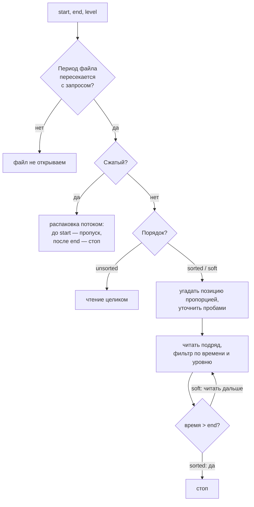
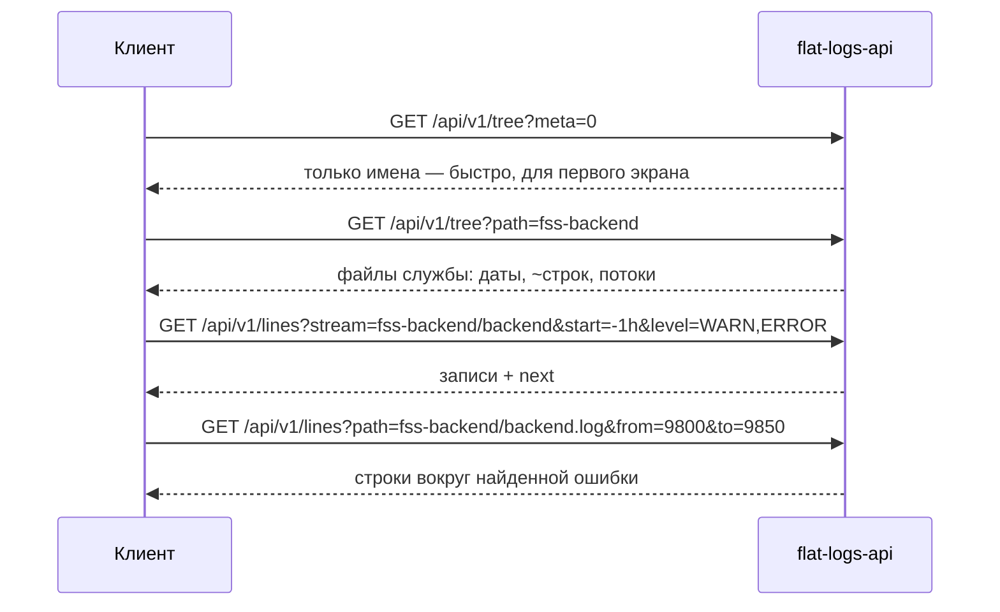
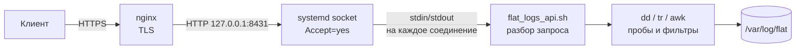
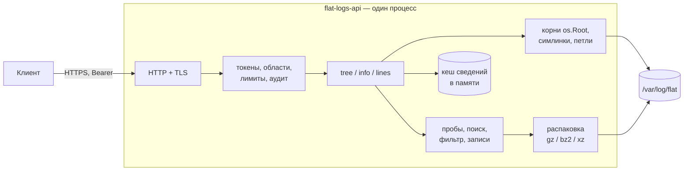
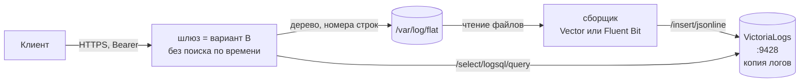

# Логи `/var/log/flat` через API — технический анализ

[← к оглавлению agent_2](../README.md) · коротко: [01 — Базовый анализ](01-brainstorm.md)

> Статус: аналитика. Кода нет, пакет не выбран. Названия `flat-logs-api`
> (служба), `flat-logs` (пользователь), порт `8431`, пути `/etc/flat-logs-api/`
> и `/opt/flat/flat-logs-api/` — рабочие, до решения по пакету.

## Содержание

1. [Цель и рамки](#1-цель-и-рамки)
2. [Принятые решения](#2-принятые-решения)
3. [Исходные данные](#3-исходные-данные)
4. [Алгоритмы](#4-алгоритмы)
5. [API](#5-api)
6. [Безопасность](#6-безопасность)
7. [Ресурсы и лимиты](#7-ресурсы-и-лимиты)
8. [Варианты реализации](#8-варианты-реализации)
9. [Ограничения и нюансы](#9-ограничения-и-нюансы)
10. [Проверка](#10-проверка)
11. [Открытые вопросы](#11-открытые-вопросы)
12. [Ссылки на код](#12-ссылки-на-код)

---

## 1. Цель и рамки

API для анализа логов в `/var/log/flat`, по возможностям похожее на
VictoriaLogs, но работающее прямо с файлами. Клиент с токеном получает
иерархию каталогов и файлов со сведениями о них, затем — строки по условиям.
Веб-интерфейс строит по этим ответам дерево и просмотр записей.

**Входит:**

- дерево `/var/log/flat` со сведениями о файлах;
- строки по номерам, по периоду, по уровню за период, весь файл;
- ротированные и сжатые файлы;
- доступ по токену, только чтение, только `/var/log/flat` и симлинки из него.

**Не входит (сейчас):**

- полнотекстовый поиск сразу по всем логам — только в варианте C;
- запись, удаление, ротация логов — API ничего не меняет;
- «живой» хвост (`tail -f`) по WebSocket/SSE — возможное развитие;
- выбор пакета и сборка.

### Соответствие требованиям

| Требование | Как закрыто |
|---|---|
| GET-запрос с API-ключом | заголовок `Authorization: Bearer <токен>` ([6.3](#63-токены)) |
| Проверка ключа и прав | токен → хеш → область доступа по каталогам; 401 / 403 |
| Анализ содержимого `/var/log/flat` | обход по запросу, чтение начала и конца файлов ([4.1](#41-обход-дерева)–[4.3](#43-сведения-о-сжатом-файле)) |
| JSON с иерархией и сведениями о файлах | `GET /api/v1/tree`: размер, первая и последняя дата, число строк (оценка) |
| Количество строк | оценка в дереве, точное — `GET /api/v1/info` |
| Строки с номера до конца | `GET /api/v1/lines?path=…&from=N` |
| Строки в диапазоне | `…&from=100&to=200` |
| Записи за период | `…&start=…&end=…` (по файлу или по потоку ротаций) |
| Уровень за период | `…&start=…&end=…&level=WARN` |
| Все записи файла | `GET /api/v1/lines?path=…` постранично |
| Не от `root` | отдельный непривилегированный пользователь, ограничения systemd ([6.1](#61-пользователь-и-права), [6.6](#66-systemd)) |
| Только `/var/log/flat` | относительные пути, симлинки только из `/var/log/flat` и по списку корней ([6.2](#62-ограничение-каталогом)) |

---

## 2. Принятые решения

| Вопрос | Решение |
|---|---|
| Индексация | фонового индекса нет. Сведения о файле — из его начала и конца, поиск по времени — «прыжками», как в `flat_check_2.sh` |
| Число строк | в дереве — оценка (`lines_exact: false`); точное — по запросу файла, `GET /api/v1/info` |
| Номер строки в ответе на запрос по времени | по умолчанию — байтовая позиция `offset`; номер строки — по флагу `line_numbers=1` |
| Формат строк | прикладной лог по образцу Log4j / Python logging: время — уровень — компонент — сообщение; уровень бывает не всегда |
| Симлинки внутри `/var/log/flat` | переходим (туда пишет сам продукт); нет прав — `permission_denied` |
| Владелец логов | учётка продукта: `flat-user` и аналоги |
| Клиенты | любые — внешние и внутренние фронты и бэкенды; критерий один: есть токен |
| Ротированные файлы | обрабатываются, включая сжатые |
| Пакет | не выбран |
| Первый запрос клиента | вся иерархия `/var/log/flat`; затем продукт и служба |

---

## 3. Исходные данные

### 3.1. Структура `/var/log/flat`

- Первый уровень — каталоги **пакетов** (`fss-backend`, `fss-server`, …), а не
  продуктов. Соответствие «пакет → продукт» есть в каталоге
  `flat_check.packages.conf` (`_pkg_set "пакет" "Продукт" …`).
- Встречаются **старые имена** пакетов (legacy) и **симлинки-алиасы**, которые
  ведут за пределы `/var/log/flat` — `flat_check_2.sh` разворачивает их через
  `readlink -f` (`find_log_dirs_for_pkg`).
- Встречаются **неизвестные каталоги** (например, `logforflat`): сборщик
  `flat_check_2.sh` их пропускает, API показывает всё, что есть.
- Внутри каталога службы могут быть подкаталоги.
- В `/var/log/flat/flat-check/` пишет свой лог `flat_check_agent.sh` — он
  тоже попадёт в дерево.

### 3.2. Имена файлов и ротации

Правила взяты из `flat_check_2.sh` (`_psl_log_group_key`, `_log_type_stem`,
`_psl_strip_logrotate_suffix`, `_psl_strip_archive_ext`).

| Вид | Примеры | Поток |
|---|---|---|
| живой файл | `backend.log`, `sipdump.txt` | `backend`, `sipdump` |
| номерная ротация | `sipdump.txt.1`, `error.log.3` | `sipdump`, `error` |
| номерная сжатая | `sipdump.txt.2.gz` | `sipdump` |
| ротация с датой | `sipdump.txt-20260731`, `sipdump.txt.-20260731`, `sipdump.txt.2026-07-31`, `name.log_2026-07-31`, то же с `.gz` | `sipdump`, `name` |
| дневной файл с датой в начале имени | `2026_07_31_service_log.log` (fcs-swau и др.) | `service_log` |
| архивы | `.gz`, `.bz2`, `.xz`, `.tar.gz`/`.tgz` | по имени без расширения |
| не читаются | `.zip`, `.Z` | в дереве есть, содержимое — нет |

- **Поток** (`stream`) — живой файл и все его ротации в одном каталоге.
  Идентификатор: `<каталог>/<стем>`, например `fss-backend/backend`.
- **Двойники**: если рядом лежат `x.txt.1` и `x.txt.1.gz` (одна и та же
  ротация дважды), читается обычный файл (`_psl_dedupe_archive_copies`).

### 3.3. Метки времени

Из `_AWK_LINE_EPOCH` в `flat_check_2.sh`. Метка ищется **только в начале
строки**: в теле SIP-сообщений (sipdump) есть заголовок `Date:`, который иначе
даёт ложное время.

| Формат в начале строки | Пример |
|---|---|
| `YYYY-MM-DD HH:MM:SS` или с `T` | `2026-12-31 22:00:00,123` |
| `DD.MM.YYYY HH:MM:SS` | `31.12.2026 22:00:00.456` |
| `DD.MM.YYYY HH:MM` | `31.12.2026 22:00` |
| `YYYY-MM-DD HH:MM` | `2026-12-31 22:00` |
| `HH:MM:SS` (дата — из имени файла, иначе из даты изменения файла) | `22:00:00:123` |

- Миллисекунды (`,123`, `.123`, `:123`) на поиск не влияют, но выводятся
  в ответе, если есть.
- Часового пояса в строке нет — время локальное для хоста
  ([4.10](#410-время-и-часовые-пояса)).

### 3.4. Формат записи и уровни

Прикладной лог по образцу Log4j / Python logging:
**время — уровень — компонент — сообщение**.

```text
2026-12-31 22:00:00,123 INFO  [main] c.f.Server - started
2026-12-31 22:00:01,456 [WARN] SipStack: retry 2/3
2026-12-31 22:00:02,789 ERROR [pool-3] c.f.Db - timeout
	at com.flat.db.Pool.get(Pool.java:42)
	at com.flat.api.Handler.run(Handler.java:17)
2026-12-31 22:00:03,001 - sip.stack - WARNING - slow reply      ← частый формат Python: имя перед уровнем
2026-12-31 22:00:04,002 heartbeat ok                            ← без уровня
```

- Уровень бывает не всегда.
- Записи бывают многострочными: трасса исключения, тело SIP-сообщения.
  Строки продолжения **не начинаются** с метки времени.

### 3.5. Права на файлы

- Логи пишет учётка продукта (`flat-user` и аналоги); у разных продуктов
  учётки могут различаться.
- Права на новые файлы задаёт продукт (umask, явный режим) и logrotate
  (`create <режим> <владелец> <группа>`).
- От режима файлов зависит модель доступа службы
  ([6.1](#61-пользователь-и-права)): при `0640` хватает группы, при `0600` —
  нет.

### 3.6. Что собрать с реального хоста

Команды только читают. В логах могут быть номера телефонов и другие
персональные данные — перед отправкой их нужно замаскировать.

```bash
du -sh /var/log/flat; find -L /var/log/flat -type f | wc -l              # объём
find /var/log/flat -type l -printf '%p -> %l\n'                         # симлинки
find -L /var/log/flat -maxdepth 3 -printf '%M %u:%g %p\n' | head -60      # владельцы и права
grep -rl /var/log/flat /etc/logrotate.d/ | xargs -r grep -HE 'create|copytruncate|compress|dateext|su '
for f in $(find -L /var/log/flat -type f ! -name '*.gz' | head -30); do
  echo "== $f"; head -n 3 "$f" | cut -c1-200
done                                                                      # форматы строк
timedatectl | grep -i 'time zone'                                        # часовой пояс хоста
```

---

## 4. Алгоритмы

### 4.1. Обход дерева

- Выполняется **по запросу**, без фонового процесса и без индекса на диске.
- Для каждого элемента — `lstat`. Каталог — спускаемся. Симлинк —
  разворачиваем и проверяем по правилам [6.2](#62-ограничение-каталогом);
  нет прав — элемент остаётся в дереве с `"error": "permission_denied"`.
- **Петли** симлинков отсекаются по паре (устройство, inode) уже
  пройденных каталогов; плюс предел глубины (например, 16).
- Токен с ограниченной областью видит только свои каталоги.
- Сведения о файлах ([4.2](#42-сведения-об-обычном-файле),
  [4.3](#43-сведения-о-сжатом-файле)) кешируются в памяти по ключу
  (устройство, inode, размер, время изменения): повторный запрос дерева не
  перечитывает неизменившиеся файлы. Это не индекс: после перезапуска кеш
  пустой и заполняется по мере запросов.

### 4.2. Сведения об обычном файле

Цена не зависит от размера файла: читаются только начало, середина и конец.

1. **`stat`** — размер и время изменения.
2. **Начало** — читаем с нуля блок 16 КБ; если строки с меткой времени в нём
   нет, удваиваем блок до 128 КБ (как `SEEK_PROBE_BYTES` в
   `flat_check_2.sh`). Первая строка с меткой → `first_ts` и распознанный
   формат времени. Не нашли — `has_ts: false`.
3. **Конец** — тот же блок от конца файла. Последняя **полная** строка
   (с `\n` в конце) с меткой → `last_ts`. Недописанная строка у растущего
   файла пропускается.
4. **Середина** — одна проба на половине размера. По трём меткам
   (начало ≤ середина ≤ конец) определяется порядок, как в
   `_logs_sort_mode`:
   - `sorted` — время растёт;
   - `soft` — начало ≤ конец, но середина «плавает» (несколько писателей:
     sipdump, clustermonitor);
   - `unsorted` — иначе.

   Известные «плавающие» потоки помечаются `soft` всегда
   (`_log_stem_is_soft_sorted`).
5. **Число строк — оценка**: размер ÷ средняя длина строки по прочитанным
   блокам → `lines`, `lines_exact: false`. Если файл целиком уместился в
   прочитанные блоки — число точное.

### 4.3. Сведения о сжатом файле

В середину сжатого файла перейти нельзя, конец без полной распаковки не
прочитать.

| Поле | Как получаем | Точность |
|---|---|---|
| `first_ts` | распаковка первых 16–128 КБ | точно |
| `lines` | `.gz`: размер распакованных данных из последних 4 байт файла (поле ISIZE) ÷ средняя длина строки; `.xz`: размер из индекса архива; `.bz2`: неизвестен до распаковки (`null`) | оценка |
| `last_ts` | наименьшая из верхних границ: `first_ts` следующего, более свежего файла потока; дата в имени (`-YYYYMMDD`) — конец этих суток; дата изменения файла | оценка, не раньше реального конца |
| `order` | по потоку (`soft`-стемы) или `sorted` | — |

- ISIZE хранит размер по модулю 4 ГБ и только для последнего фрагмента
  архива. Если распакованные данные явно больше 4 ГБ или архив склеен из
  нескольких, оценка числа строк — `null`.
- У «плавающих» потоков (`soft`) следующий файл может начинаться чуть раньше
  конца предыдущего, поэтому к оценке `last_ts` добавляется допуск
  (в `flat_check_2.sh` — 300 с, `LOG_ARCHIVE_EARLY_STOP_GRACE_SEC`).
- Архив больше не меняется: точные значения, полученные при полном чтении,
  можно держать в кеше до перезапуска.

### 4.4. Точные сведения по запросу

`GET /api/v1/info` читает файл целиком **один раз** и считает:

- точное число строк;
- точные `first_ts` и `last_ts` (для архивов — тоже);
- число строк по уровням (`INFO`, `WARN`, `ERROR`, …, `none`).

Правила:

- результат кешируется по (устройство, inode, размер, время изменения);
- растущий файл (тот же inode, размер больше) досчитывается только по
  дописанной части;
- файл стал короче (`copytruncate`) — считается заново;
- одновременные запросы к одному файлу считаются один раз, остальные ждут
  результат.

### 4.5. Потоки ротаций

- Файлы каталога группируются по стему ([3.2](#32-имена-файлов-и-ротации)).
- Порядок внутри потока — по `first_ts` (он точный у всех файлов), а не по
  номеру ротации в имени.
- Период потока — от `first_ts` самого старого до `last_ts` живого файла.
- Запрос по времени к потоку ([4.7](#47-запрос-по-времени)) сам выбирает
  файлы: клиенту не нужно знать, в каком архиве лежат нужные сутки.

### 4.6. Запрос по номерам строк

- Номера строк — с 1, как в `sed -n` и редакторах.
- До строки `from` файл читается с начала с подсчётом `\n`, без разбора
  содержимого — со скоростью диска.
- Если точное число строк уже известно (`/info`) и `from` во второй половине
  файла, счёт ведётся от конца.
- Страница — до `limit` строк. Курсор следующей страницы хранит inode, байтовую
  позицию и номер строки: следующая страница читается сразу с нужного места.
- Если между страницами файл ротировали или обрезали (inode другой или размер
  меньше позиции курсора) — ошибка `file_changed`, клиент начинает заново.
- У сжатого файла каждая страница — распаковка с начала до позиции курсора.
  Для архивов лучше крупные страницы.

### 4.7. Запрос по времени

Тот же алгоритм, что в `flat_check_2.sh`: `_psl_find_offset_for_epoch`
(интерполяционный поиск), `_binsearch_offset_ge` (бисекция),
`_awk_filter_range_prog` (фильтр с ранней остановкой).



**Шаги для обычного файла:**

1. **Отсев.** Период файла `[first_ts, last_ts]` не пересекается с
   `[start, end]` — файл не открываем.
2. **Угадывание.** Доля = (`start` − `first_ts`) ÷ (`last_ts` − `first_ts`);
   позиция ≈ доля × размер.
   - Пример: файл 31.12.2026 22:00:00 – 01.01.2027 02:48:53 (17 333 с), запрос
     с 01.01.2027 01:00:00 → (10 800 ÷ 17 333) ≈ 0,62 → 62 % размера.
   - Если `start` раньше начала файла — с нуля; `end` позже конца — до конца,
     второй поиск не нужен.
3. **Уточнение.** Читаем первую полную строку после позиции. Время меньше
   `start` — окно сдвигается вперёд, больше — назад; следующее угадывание —
   той же пропорцией внутри нового окна.
   - Каждый шаг обязан сузить окно минимум на 1/10
     (`_PSL_MIN_PROGRESS_FRAC=10`): неравномерные логи (всплески, затишья) не
     превращают поиск в линейный просмотр.
   - Строка без метки времени при пробе — сдвиг на 4 КБ и повтор.
   - Стоп, когда окно меньше блока пробы (128 КБ).
4. **Запас назад.** От найденной позиции отступаем: для `sorted` — 1 МБ
   (`SEEK_BACKOFF_BYTES`), для `soft` — 32 МБ
   (`SEEK_SOFT_SORT_BACKOFF_BYTES`), затем выравниваем на начало строки.
5. **Чтение.** Читаем подряд, собираем записи ([4.9](#49-многострочные-записи)),
   фильтруем по времени и уровню.
6. **Остановка:**
   - `sorted` — время записи > `end` + допуск (300 с);
   - `soft` — ранней остановки нет, читается до конца окна;
   - набран `limit` — ответ + курсор;
   - прочитано `max_scan_bytes` или вышло время запроса — частичный ответ
     + курсор ([7](#7-ресурсы-и-лимиты)).

**Сжатый файл:** распаковка потоком с начала; записи до `start`
пропускаются, после `end` (+ допуск) — стоп; для `soft` — без ранней
остановки.

**Поток:** шаг 1 для каждого файла потока, затем шаги 2–6 по попавшим
файлам в хронологическом порядке ([4.5](#45-потоки-ротаций)).

**Номер строки в ответе.** После «прыжка» номер строки неизвестен.
По умолчанию в записи есть `offset` — байтовая позиция начала записи;
по ней клиент запрашивает соседние строки. С `line_numbers=1` служба
досчитывает номера, читая файл с начала до найденного места.

### 4.8. Уровни

- Ищем **после метки времени**, в первых трёх «словах». Разделители — пробелы,
  `-`, `|`, `:`, квадратные скобки снимаются (`[WARN]` → `WARN`).
  Выравнивание пробелами (`INFO  `) не мешает.
- Текст сообщения **не проверяем**: `INFO … ERROR in reply` — это `INFO`.
- Регистр — по умолчанию только верхний (`WARN`, не `warn`): иначе ложные
  совпадения с именами компонентов. Включается в конфиге.
- Нормализация к виду Log4j:

| В строке | В ответе |
|---|---|
| `TRACE` | `TRACE` |
| `DEBUG` | `DEBUG` |
| `INFO` | `INFO` |
| `WARN`, `WARNING` | `WARN` |
| `ERROR` | `ERROR` |
| `FATAL`, `CRITICAL` | `FATAL` |
| нет уровня | `null` |

- Фильтр принимает список: `level=WARN,ERROR`. Регистр в параметре не важен,
  `warning` = `WARN`.
- Записи без уровня под фильтр по уровню не попадают.

### 4.9. Многострочные записи

- **Запись** — строка с меткой времени плюс все следующие строки без метки.
- Строки продолжения получают время и уровень своей записи: фильтр
  `level=ERROR` вернёт ошибку вместе с трассой исключения.
- В запросах **по номерам строк** каждая строка — отдельный элемент ответа,
  у строк продолжения `ts` и `level` — `null`, `cont: true`.
- В запросах **по времени и уровню** элемент ответа — запись целиком:
  `text` с `\n` внутри, `lines` — сколько строк в записи.
- Предел записи — например, 1000 строк или 1 МБ; дальше `text` обрезается
  (`truncated: true`).
- Файл без меток времени (`has_ts: false`): запросы по времени и уровню
  возвращают ошибку `no_timestamps`, по номерам строк — работают.

### 4.10. Время и часовые пояса

- **Параметры** `start`/`end` принимают: RFC 3339 со смещением
  (`2027-01-01T01:00:00+03:00`), локальное время хоста
  (`2027-01-01 01:00:00`, `01.01.2027 01:00:00`), unix-секунды,
  относительное (`-1h`, `-2d`).
- **В ответах** — RFC 3339 со смещением хоста и миллисекундами, если они
  есть в строке.
- **Часовой пояс** — системный пояс хоста. Если продукт пишет логи в другом
  поясе (например, Java с `-Duser.timezone=UTC` на хосте с MSK), пояс
  задаётся в конфиге для каталога.
- **Переход на летнее время.** В поясах с переводом часов один час осенью
  повторяется: время в файле на этот час не монотонно. Для РФ неактуально
  (перевода нет с 2014 года), для других поясов файл в этот час ведёт себя
  как `soft`.
- **Файлы только с `HH:MM:SS`.** Дата берётся из имени файла, иначе из даты
  изменения (`_infer_file_midnight_epoch`). Строки после полуночи в файле
  предыдущего дня получат неверную дату. Правило: если время уменьшилось
  больше чем на 12 ч относительно предыдущей строки — +1 сутки.
  Для проб в середине файла это правило не работает (предыдущей строки нет),
  поэтому около полуночи такие файлы читаются целиком.
- **Новый год** проблем не создаёт: во всех форматах, кроме `HH:MM:SS`,
  есть год.

### 4.11. Кодировка и «грязные» строки

- JSON требует корректный UTF-8. Некорректные байты заменяются на `U+FFFD`,
  у записи — `lossy: true`.
- Байты NUL удаляются (как `tr -d '\0'` в `flat_check_2.sh`).
- `\r` в конце строки (CRLF) снимается.
- Строка длиннее `max_line_bytes` (например, 64 КБ) обрезается,
  `truncated: true`.

---

## 5. API

### 5.1. Общее

- Базовый путь: `/api/v1`.
- Только `GET`. Ответы — `application/json; charset=utf-8`.
- Авторизация: `Authorization: Bearer <токен>`. Токен в строке запроса
  не принимается — иначе он оседает в журналах nginx и прокси.
- Пути (`path`, `stream`) — **относительно `/var/log/flat`**, как в ответе
  `tree`.
- Ошибки — единый формат ([5.6](#56-ошибки)).

### 5.2. `GET /api/v1/tree` — иерархия

Первый запрос клиента: что есть на сервере.

| Параметр | По умолчанию | Значение |
|---|---|---|
| `path` | корень | поддерево, например `fss-backend` |
| `depth` | без предела | глубина обхода |
| `meta` | `1` | `0` — только имена и размеры, без чтения файлов (самый быстрый ответ) |

Заголовок `ETag`: если ничего не изменилось, повторный запрос с
`If-None-Match` получает `304` без тела.

```json
{
  "root": "/var/log/flat",
  "generated_at": "2027-01-01T03:00:05+03:00",
  "children": [
    {
      "name": "fss-backend", "path": "fss-backend", "type": "dir",
      "streams": [
        {"stream": "fss-backend/backend", "files": 3,
         "first_ts": "2026-12-29T00:00:01+03:00", "last_ts": "2027-01-01T02:48:53+03:00"}
      ],
      "children": [
        {
          "name": "backend.log", "path": "fss-backend/backend.log", "type": "file",
          "stream": "fss-backend/backend", "compressed": null,
          "size": 1048576, "mtime": "2027-01-01T02:48:53+03:00",
          "has_ts": true, "order": "sorted",
          "first_ts": "2026-12-31T22:00:00+03:00", "last_ts": "2027-01-01T02:48:53+03:00",
          "last_ts_exact": true,
          "lines": 10000, "lines_exact": false
        },
        {
          "name": "backend.log.1.gz", "path": "fss-backend/backend.log.1.gz", "type": "file",
          "stream": "fss-backend/backend", "compressed": "gzip",
          "size": 2097152, "mtime": "2026-12-31T22:00:00+03:00",
          "has_ts": true, "order": "sorted",
          "first_ts": "2026-12-30T22:00:00+03:00", "last_ts": "2026-12-31T22:00:00+03:00",
          "last_ts_exact": false,
          "lines": 98000, "lines_exact": false
        }
      ]
    },
    {"name": "fss-server", "path": "fss-server", "type": "dir", "symlink": true,
     "error": "permission_denied"}
  ]
}
```

| Поле | Значение |
|---|---|
| `type` | `dir`, `file`, `other` (сокеты, устройства — не читаются) |
| `symlink` | `true`, если элемент — симлинк (путь цели не раскрывается) |
| `error` | `permission_denied`, `outside_allowed`, `loop`, `not_found` (симлинк в никуда), `unsupported_archive` |
| `stream` | поток ротаций, к которому относится файл |
| `compressed` | `null`, `gzip`, `bzip2`, `xz`, `tar.gz` |
| `has_ts` | найдена ли метка времени в начале файла |
| `order` | `sorted`, `soft`, `unsorted` |
| `first_ts`, `last_ts` | первая и последняя метка; `last_ts_exact: false` — оценка (архивы) |
| `lines`, `lines_exact` | число строк; `false` — оценка, `null` — неизвестно |

### 5.3. `GET /api/v1/info` — точные сведения

| Параметр | Значение |
|---|---|
| `path` | файл; или |
| `stream` | поток — сумма по его файлам |

```json
{
  "path": "fss-backend/backend.log",
  "size": 1048576, "mtime": "2027-01-01T02:48:53+03:00",
  "first_ts": "2026-12-31T22:00:00+03:00", "last_ts": "2027-01-01T02:48:53+03:00",
  "last_ts_exact": true,
  "lines": 10342, "lines_exact": true,
  "records": 9870,
  "levels": {"TRACE": 0, "DEBUG": 0, "INFO": 9512, "WARN": 301, "ERROR": 52, "FATAL": 0, "none": 5},
  "order": "sorted",
  "cached": false, "elapsed_ms": 41
}
```

Читает файл целиком ([4.4](#44-точные-сведения-по-запросу)); на больших
архивах — секунды и больше. Результат кешируется.

### 5.4. `GET /api/v1/lines` — строки и записи

| Параметр | Значение |
|---|---|
| `path` | файл |
| `stream` | поток ротаций (только для запросов по времени и уровню) |
| `from`, `to` | номера строк, с 1, включительно |
| `start`, `end` | период ([4.10](#410-время-и-часовые-пояса)) |
| `level` | список уровней: `WARN,ERROR` |
| `limit` | элементов на странице: по умолчанию 1000, максимум 10 000 |
| `cursor` | продолжение с прошлой страницы (непрозрачная строка) |
| `line_numbers` | `1` — номера строк в запросах по времени ([4.7](#47-запрос-по-времени)) |

**Режимы:**

| Запрос | Параметры | Элемент ответа |
|---|---|---|
| весь файл | `path` | строка |
| с N-й до конца | `path`, `from` | строка |
| диапазон строк | `path`, `from`, `to` | строка |
| за период | `path` или `stream`, `start`, `end` | запись |
| уровень за период | + `level` | запись |
| уровень по всему файлу | `path`/`stream`, `level` без периода | запись (читается всё — дорого) |

Одновременно `from`/`to` и `start`/`end` — ошибка `conflicting_params`.
Одна граница периода допустима: `start` без `end` — до конца, `end` без
`start` — с начала.

**Ответ по номерам строк:**

```json
{
  "path": "fss-backend/backend.log", "mode": "lines",
  "items": [
    {"line": 100, "offset": 20480, "ts": "2026-12-31T22:14:07.120+03:00", "level": "ERROR",
     "text": "2026-12-31 22:14:07,120 ERROR [pool-3] c.f.Db - timeout"},
    {"line": 101, "offset": 20538, "ts": null, "level": null, "cont": true,
     "text": "\tat com.flat.db.Pool.get(Pool.java:42)"}
  ],
  "next": "eyJpIjo0MjEsIm8iOjIwNjAwLCJsIjoyMDB9",
  "stop": "limit",
  "stats": {"bytes_read": 21504, "elapsed_ms": 3}
}
```

**Ответ по времени и уровню:**

```json
{
  "stream": "fss-backend/backend", "mode": "time",
  "items": [
    {"path": "fss-backend/backend.log", "offset": 652113, "line": null,
     "ts": "2027-01-01T01:00:04.311+03:00", "level": "WARN", "lines": 1,
     "text": "2027-01-01 01:00:04,311 WARN [main] c.f.Sip - retry 2/3"}
  ],
  "next": null,
  "stop": "end",
  "stats": {"files_total": 3, "files_skipped": 2, "files_read": 1,
            "probes": 6, "bytes_read": 401408, "elapsed_ms": 12}
}
```

| Поле | Значение |
|---|---|
| `next` | курсор следующей страницы; `null` — данных больше нет |
| `stop` | почему остановились: `end` (конец данных), `limit`, `scan_limit` (прочитано `max_scan_bytes`), `timeout` |
| `stats.probes` | сколько проб понадобилось поиску |

`scan_limit` и `timeout` — не ошибки: ответ `200`, найденное отдаётся,
поиск продолжается с курсора. Это важно для редких уровней: чтобы набрать
1000 `ERROR`, иногда нужно прочитать гигабайты.

**Курсор** кодирует файл (inode), позицию и номер строки. Если файл
ротировали или обрезали, курсор отклоняется с `file_changed`.

### 5.5. `GET /api/v1/health`

Без токена, только `{"status": "ok"}` — для проверки живости. Версия и
сведения о хосте — только с токеном.

### 5.6. Ошибки

```json
{"error": {"code": "permission_denied", "message": "fss-server/app.log: permission denied"}}
```

| HTTP | `code` | Когда |
|---|---|---|
| 400 | `bad_request`, `invalid_path`, `invalid_time`, `invalid_range`, `conflicting_params` | ошибка в параметрах |
| 401 | `unauthorized` | нет токена или неверный (`WWW-Authenticate: Bearer`) |
| 403 | `forbidden` | путь вне области токена |
| 403 | `permission_denied` | нет прав у пользователя службы |
| 403 | `outside_allowed` | симлинк ведёт за разрешённые корни |
| 404 | `not_found` | нет такого файла или потока |
| 409 | `file_changed` | файл ротировали или обрезали между страницами |
| 422 | `no_timestamps` | запрос по времени к файлу без меток |
| 422 | `unsupported_archive` | `.zip`, `.Z` |
| 429 | `too_many_requests` | превышены лимиты; `Retry-After` |
| 503 | `host_busy` | хост загружен ≥ 80 % CPU или памяти; `Retry-After` |
| 500 | `internal` | ошибка службы |

### 5.7. Типовой сценарий клиента



### 5.8. Возможные расширения

- `tail=N` — последние N строк файла (дёшево: чтение с конца).
- Гистограмма числа записей по уровням во времени (как `hits` в
  VictoriaLogs) — требует полного чтения, поэтому только через `/info` с
  кешем или в варианте C.
- «Живой» хвост через SSE.

---

## 6. Безопасность

### 6.1. Пользователь и права

- Служба работает от **отдельного системного пользователя** (`flat-logs`) без
  shell и без домашнего каталога. Не `root`, без capabilities.
  `CAP_DAC_READ_SEARCH` не используется: она разрешает читать любой файл в
  системе.
- Доступ к логам — через **группы продуктов**: `flat-logs` добавляется в
  группу каждого продукта (`SupplementaryGroups=` в юните). Это работает,
  если файлы логов доступны группе на чтение (`0640` и шире).
- Если файлы создаются с `0600`:
  - **POSIX ACL** (`setfacl -d -m g:flat-logs:rX`) помогает, только если
    `0600` получается из umask. Если продукт или logrotate явно задают
    `0600` (`create 0600 …`), маска ACL обнуляет права группы — не поможет.
  - Тогда остаётся одно из двух: продукт или logrotate создают файлы с
    `0640`, либо служба работает от учётки продукта.
- **Запуск от учётки продукта** (`flat-user`) проще, но при взломе API
  атакующий получает права продукта: может менять его файлы и останавливать
  процессы. Требование «отдельный пользователь» при этом не выполняется.
- Какой вариант возможен — видно по выводу команд [3.6](#36-что-собрать-с-реального-хоста).

### 6.2. Ограничение каталогом

**Правила для пути из запроса:**

- только относительный путь, как в ответе `tree`;
- корректный UTF-8, без NUL, длина до 4096 байт, компонент до 255;
- без `..`, без `.`, без пустых компонентов, без ведущего `/`;
- путь должен совпадать со своей нормализованной формой — иначе
  `invalid_path` (никаких «хитрых» записей одного и того же пути).

**Симлинки:**

- Переходим по симлинкам, которые **лежат внутри `/var/log/flat`**. Создать
  свой симлинк клиент не может — API только читает.
- Цель симлинка проверяется по списку **разрешённых корней** в конфиге,
  например `/var/log` и `/opt/flat`. Цель вне списка — `outside_allowed`.
  Пустой список — разрешено всё, тогда граница только в правах пользователя
  службы.
- Зачем список: если в `/var/log/flat` окажется симлинк на `/etc` или на
  каталог конфигов продукта с паролями, без списка API их отдаст в пределах
  прав пользователя службы.
- Нет прав на цель — `permission_denied`; цели нет — `not_found`;
  петля — `loop`.
- Путь цели в ответах не раскрывается.

**Реализация (вариант B, Go):**

- Каждый разрешённый корень открывается как `os.Root` (Go 1.24+). Через
  `os.Root` файл открывается только внутри корня — с проверкой на каждом
  шаге пути, включая симлинки.
- Запрос сначала открывается в корне `/var/log/flat`. Если путь уходит
  наружу по симлинку — цель разворачивается, подбирается разрешённый корень,
  который её содержит, и файл открывается уже через этот корень.
- Если симлинк подменят между проверкой и открытием, `os.Root` всё равно не
  выпустит за пределы разрешённого корня: худший случай — другой файл внутри
  разрешённого корня.

**Реализация (вариант A, bash):** `realpath -e` и проверка префикса. Между
проверкой и открытием симлинк можно подменить — защита слабее
([8.1](#81-вариант-a-bash--awk)).

### 6.3. Токены

- Формат: 32 случайных байта, hex (64 символа):
  `openssl rand -hex 32`.
- В конфиге хранится **только SHA-256** токена:
  `printf '%s' "$TOKEN" | sha256sum`. Сравнение — за постоянное время.
- У токена: имя (для аудита), область, срок действия.

```yaml
# /etc/flat-logs-api/tokens.yml — 0640 root:flat-logs
tokens:
  - name: support-portal
    sha256: 9f86d081884c7d659a2feaa0c55ad015a3bf4f1b2b0b822cd15d6c15b0f00a08
    scope: ["*"]                       # все каталоги /var/log/flat
  - name: softswitch-backend
    sha256: 2c26b46b68ffc68ff99b453c1d30413413422d706483bfa0f98a5e886266e7ae
    scope: ["fss-*"]                   # маски по первому уровню
    expires: 2027-06-30
```

- Перечитывается по `SIGHUP`, без перезапуска: выпуск и отзыв — правкой файла.
- Только чтение: токен не даёт никаких операций записи — их в API нет.
- Токен даёт доступ к содержимому логов, а там бывают персональные данные
  (номера телефонов, SIP-заголовки). Область токена — минимально нужная.

### 6.4. Транспорт

- Клиенты бывают внешние, поэтому снаружи — только **HTTPS**:
  - TLS в самой службе (сертификат и ключ в конфиге), или
  - служба на `127.0.0.1`, снаружи — nginx продукта с TLS.
- Служба **отказывается стартовать**, если слушает не `127.0.0.1` и TLS не
  настроен: токен не должен ходить открытым текстом.
- **CORS** выключен. Если внешний фронт ходит к API прямо из браузера —
  список разрешённых адресов в конфиге (`cors_origins`); но токен при этом
  виден пользователю этого фронта. Надёжнее, когда браузер ходит через свой
  бэкенд, а токен хранится на бэкенде.

### 6.5. Защита от перегрузки

- Лимиты на запрос: `limit`, `max_scan_bytes`, время запроса, размер ответа,
  длина строки ([7](#7-ресурсы-и-лимиты)).
- Ограничение одновременных тяжёлых запросов (`/info`, чтение архивов,
  уровень без периода); лишние ждут в очереди, потом `429`.
- Лимит частоты запросов на токен; неверные токены — отдельный лимит на
  адрес клиента.
- Если хост уже загружен ≥ 80 % CPU или памяти, тяжёлые запросы получают
  `503` с `Retry-After` — тот же порог, что у `flat_check_2.sh`
  (`RESOURCE_CPU_LIMIT`, `RESOURCE_MEM_LIMIT`; он согласован с Zabbix).

### 6.6. systemd

Юнит для варианта B (для A — в [8.1](#81-вариант-a-bash--awk)):

```ini
# /lib/systemd/system/flat-logs-api.service — рабочий пример
[Unit]
Description=flat-logs-api: read-only API for /var/log/flat
After=network.target

[Service]
Type=simple
User=flat-logs
Group=flat-logs
# Группы продуктов, чьи логи читаем.
SupplementaryGroups=flat-group
ExecStart=/opt/flat/flat-logs-api/bin/flat-logs-api -config /etc/flat-logs-api/config.yml
ExecReload=/bin/kill -HUP $MAINPID
Restart=on-failure

# Привилегий нет и не будет.
NoNewPrivileges=yes
CapabilityBoundingSet=
AmbientCapabilities=

# Файловая система: всё только для чтения, из /var/log виден только /var/log/flat.
ProtectSystem=strict
ProtectHome=yes
PrivateTmp=yes
PrivateDevices=yes
TemporaryFileSystem=/var/log:ro
BindReadOnlyPaths=/var/log/flat
# Для каждого разрешённого корня симлинков внутри /var/log — свой BindReadOnlyPaths.

# Ядро и системные вызовы.
ProtectKernelTunables=yes
ProtectKernelModules=yes
ProtectControlGroups=yes
RestrictSUIDSGID=yes
LockPersonality=yes
MemoryDenyWriteExecute=yes
RestrictAddressFamilies=AF_INET AF_INET6 AF_UNIX
SystemCallArchitectures=native
SystemCallFilter=@system-service

# Не мешать продукту.
Nice=10
IOSchedulingClass=best-effort
IOSchedulingPriority=7
CPUQuota=50%
MemoryMax=256M

[Install]
WantedBy=multi-user.target
```

- `TemporaryFileSystem=/var/log:ro` + `BindReadOnlyPaths=/var/log/flat` —
  процесс не видит остального `/var/log`. Симлинки из `/var/log/flat`
  в другие места `/var/log` после этого не откроются, пока их корень не
  добавлен отдельным `BindReadOnlyPaths=`. Список в юните должен совпадать
  со списком разрешённых корней в конфиге.
- `/opt/flat` при `ProtectSystem=strict` виден только для чтения.
- Значения `CPUQuota` и `MemoryMax` — до замеров на прототипе.

### 6.7. Аудит

Одна строка в journald на запрос: время, адрес клиента, **имя** токена,
метод, путь API, `path`/`stream`, параметры, код ответа, байт отдано,
элементов, длительность. Сам токен и содержимое логов в аудит не пишутся.

### 6.8. Чего служба не делает никогда

- не пишет, не удаляет и не переименовывает файлы;
- не запускает внешние команды по данным из запроса (в варианте B — вообще
  не запускает внешние команды);
- не принимает абсолютные пути и `..`;
- не раскрывает пути целей симлинков;
- не обращается во внешнюю сеть.

---

## 7. Ресурсы и лимиты

### 7.1. Цена запросов

| Запрос | Что читается | Цена |
|---|---|---|
| `tree?meta=0` | только каталоги | `readdir` + `stat`, почти бесплатно |
| `tree` | по файлу: начало, середина, конец по 16–128 КБ; у архивов — начало и последние 4 байта | для 200 файлов — от единиц до десятков МБ; повторно — из кеша |
| `info` | файл целиком; архив — полная распаковка | скорость диска / распаковки; потом из кеша |
| `lines` по номерам | от начала (или конца) до `from`, затем страница | подсчёт `\n` без разбора — со скоростью диска |
| `lines` по времени, `sorted` | пробы + страница | обычно до двух-трёх десятков проб по ≤ 128 КБ, даже на многогигабайтном файле |
| `lines` по времени, `soft` | пробы + запас 32 МБ + окно без ранней остановки | десятки МБ |
| `lines` по времени, `unsorted` | файл целиком | как `info` |
| `lines` по архиву | распаковка с начала до конца периода | как `info` в худшем случае |
| `level` без периода | файл целиком | как `info` |

Для `_binsearch_offset_ge` в `flat_check_2.sh` записана оценка: файл 30 ГБ —
около 35 проб по 128 КБ, несколько МБ чтения. Интерполяционный поиск обычно
сходится быстрее.

### 7.2. Настройки по умолчанию (предложение)

| Параметр | Значение | Зачем |
|---|---|---|
| `listen` | `127.0.0.1:8431` | наружу — только с TLS |
| `root` | `/var/log/flat` | |
| `symlink_roots` | `/var/log`, `/opt/flat` | куда могут вести симлинки |
| `probe_bytes` | 16 КБ → до 128 КБ | пробы начала, конца, поиска |
| `limit` по умолчанию / максимум | 1000 / 10 000 | размер страницы |
| `max_line_bytes` | 64 КБ | обрезка длинных строк |
| `max_record_lines` | 1000 | обрезка длинных записей |
| `max_response_bytes` | 16 МБ | размер ответа |
| `max_scan_bytes` | 512 МБ | сколько читать за один запрос |
| `request_timeout` | 30 с | после — частичный ответ с курсором |
| `max_heavy_concurrent` | 2 | одновременные тяжёлые запросы |
| `rate_limit` | 10 запросов/с на токен | |
| `host_cpu_limit`, `host_mem_limit` | 80 % | как `flat_check_2.sh` |
| `cache_entries` | 10 000 | сведения о файлах в памяти |
| `level_case_insensitive` | `false` | [4.8](#48-уровни) |
| `dir_tz` | пусто | пояс для каталога ([4.10](#410-время-и-часовые-пояса)) |
| `early_stop_grace` | 300 с | допуск при ранней остановке |

Все числа — стартовые, уточняются замерами на прототипе и реальных объёмах
логов.

---

## 8. Варианты реализации

Все три варианта реализуют один контракт API ([5](#5-api)) и одни правила
безопасности ([6](#6-безопасность)). Отличаются тем, на чём построены.

### 8.1. Вариант A: bash + awk

Наследник `flat_check_2.sh` и подхода flat-check agent (один файл на bash,
без внешних зависимостей).



**Устройство:**

- systemd принимает соединение и на каждое запускает экземпляр скрипта;
  сокет — на `127.0.0.1`, TLS — nginx.
- Скрипт сам разбирает HTTP: строку запроса, заголовки, раскодирование URL;
  сам собирает JSON.
- Логика — копия функций `flat_check_2.sh` ([12](#12-ссылки-на-код)).
  Подключить `flat_check_2.sh` как библиотеку нельзя: это монолит со своим
  `main`.

```ini
# flat-logs-api.socket
[Socket]
ListenStream=127.0.0.1:8431
Accept=yes
MaxConnections=8

# flat-logs-api@.service
[Service]
User=flat-logs
SupplementaryGroups=flat-group
ExecStart=/opt/flat/flat-logs-api/flat_logs_api.sh
StandardInput=socket
StandardOutput=socket
RuntimeMaxSec=60
# + те же ограничения, что в 6.6
```

**Плюсы:**

- самый быстрый путь к прототипу;
- проверенная логика поиска, форматов и ротаций уже есть;
- без новых зависимостей: bash, gawk, coreutils, gzip уже стоят на хостах;
- ничего не собирать.

**Минусы и риски:**

- **Разбор HTTP и сборка JSON на bash** — главный источник уязвимостей:
  раскодирование URL, экранирование управляющих символов, проверка UTF-8
  (`iconv -c`), заголовки большой длины.
- **Проверка пути** через `realpath` уязвима к подмене симлинка между
  проверкой и открытием.
- **Сравнение токена** за постоянное время на bash не сделать; сравнение
  хешей снижает риск, но не убирает.
- **Третья копия кода** `flat_check_2.sh`. По `CONTEXT.md` ручной паритет
  между копиями — источник большинства прошлых багов (п. 13–23, 24).
- **Процессы**: каждая проба — запуск `dd`, `tr`, `awk`. Дерево на 200
  файлов × 3 пробы — около 1800 процессов, секунды на ответ.
- **Кеш** между запросами — только файлами на диске (процесс живёт один
  запрос).
- Нет тестов уровня модулей; отладка — по логам.

**Когда уместен:** одноразовый прототип, чтобы согласовать контракт API с
фронтом на реальных логах. В продакшен — не рекомендуется.

### 8.2. Вариант B: Go-служба

В духе agent 2: статический бинарник, только чтение, всё ограничено
systemd, снаружи — TLS.



**Состав:**

| Часть | Что делает | Откуда логика |
|---|---|---|
| HTTP, TLS | `net/http`, `crypto/tls` из стандартной библиотеки | — |
| Токены | SHA-256, сравнение за постоянное время, области, `SIGHUP` | [6.3](#63-токены) |
| Файловая система | `os.Root` на каждый разрешённый корень, симлинки, петли | [6.2](#62-ограничение-каталогом) |
| Метки времени | регулярные выражения по форматам, дата из имени файла | `_AWK_LINE_EPOCH`, `_infer_file_midnight_epoch` |
| Уровни | первые слова после времени, нормализация | новое ([4.8](#48-уровни)) |
| Потоки | стемы и ротации | `_psl_log_group_key`, `_log_type_stem` |
| Поиск | интерполяция с минимальным шагом 1/10, бисекция, запас, ранняя остановка | `_psl_find_offset_for_epoch`, `_binsearch_offset_ge`, TUNABLES |
| Порядок | три пробы, список `soft`-стемов | `_logs_sort_mode`, `_log_stem_is_soft_sorted` |
| Распаковка | `compress/gzip`, `compress/bzip2` из стандартной библиотеки; xz — сторонняя библиотека | `_log_stream_decompress` |
| Кеш | в памяти, по (устройство, inode, размер, время изменения), с вытеснением | [4.1](#41-обход-дерева) |

**Сборка:** `CGO_ENABLED=0`, статический бинарник, как остальные компоненты
agent 2 ([06 — Сборка и пакет](../docs/06-packaging.md)). Лицензии
сторонних модулей — по правилам [07 — Лицензии](../docs/07-licenses.md).

**Плюсы:**

- надёжная защита путей (`os.Root`) и токенов;
- один процесс: кеш, пробы без запуска внешних программ, параллельные
  запросы;
- тесты на каждую часть: форматы времени, уровни, ротации, попытки выйти
  из каталога;
- ложится в архитектуру agent 2: статический бинарник, systemd, TLS или
  nginx перед службой;
- без состояния на диске и без фоновой нагрузки.

**Минусы:**

- свой код на Go (agent 2 декларирует «своё с нуля не пишем», но
  `flat-exporter` — такое же исключение);
- логику `flat_check_2.sh` нужно перенести и покрыть тестами на тех же
  форматах и тех же краевых случаях;
- нужна сборка в CI.

### 8.3. Вариант C: VictoriaLogs + шлюз

Готовая база логов из той же экосистемы, что VictoriaMetrics в agent 2.



**Устройство:**

- **VictoriaLogs** (single-node, Apache-2.0) — хранит логи, язык запросов
  LogsQL, свой веб-интерфейс.
- **Сборщик** читает файлы `/var/log/flat` с начала (иначе история не
  попадёт), склеивает многострочные записи, разбирает время и уровень и
  отправляет записи в VictoriaLogs.
- **Шлюз** — токены, дерево, номера строк (VictoriaLogs про них не знает);
  запросы по времени и уровню переводит в LogsQL:

```text
_time:[2027-01-01T01:00:00+03:00, 2027-01-02T12:00:00+03:00] _stream:{dir="fss-backend",stem="backend"} level:WARN
```

**Плюсы:**

- поиск сразу по всем логам, по любому тексту, с фильтрами и агрегациями;
- гистограммы (`/select/logsql/hits`) — графики частоты ошибок;
- запросы по времени не зависят от порядка строк в файлах;
- готовый компонент, как VictoriaMetrics в agent 2.

**Минусы и нюансы:**

- **Шлюз из B нужен всё равно**: дерево, число строк, номера строк — это
  про файлы, а не про базу.
- **Копия логов**: диск и память на виртуалке продукта сверх самих логов.
  Нужны свой срок хранения (`-retentionPeriod`) и предел памяти.
- **История**: при первом запуске сборщик должен прочитать все файлы с
  начала; старые `.gz` — отдельный импорт.
- **Время записи**: если сборщик не разобрал метку времени, запись получает
  время приёма — история «съезжает» на момент импорта.
- **Задержка**: новые строки видны с задержкой сборщика (секунды).
- **Два новых компонента** в пакете: обновления, конфиги, лицензии
  (Fluent Bit — Apache-2.0, Vector — MPL-2.0).
- **Своей авторизации** у VictoriaLogs нет — только через шлюз или nginx.

### 8.4. Сравнение

| Критерий | A. bash + awk | B. Go | C. VictoriaLogs + шлюз |
|---|---|---|---|
| Дерево и сведения о файлах | да | да | только шлюзом |
| Строки по номерам | да | да | только шлюзом |
| Период и уровень по файлу или потоку | да | да | да, по всем логам сразу |
| Поиск текста по всем логам | нет | нет (можно простой) | да |
| Защита пути | слабее (проверка, затем открытие) | сильная (`os.Root`) | сильная (шлюз) |
| Токены | хеши, без постоянного времени | хеши, постоянное время | шлюз |
| Скорость на больших файлах | средняя (процессы на пробу) | высокая | высокая по времени |
| Дополнительный диск | нет | нет | копия логов |
| Состояние | нет (кеш — файлами) | кеш в памяти | база |
| Новые зависимости на хосте | нет | нет (статический бинарник) | VictoriaLogs, сборщик |
| Переиспользование `flat_check_2.sh` | копия кода | перенос алгоритма | частично (шлюз) |
| Тестируемость | низкая | высокая | средняя |
| Время до прототипа | меньше всего | среднее | больше всего |
| Поддержка | третья копия логики на bash | свой код на Go | два внешних компонента + шлюз |

### 8.5. Рекомендация и этапы

**Вариант B.** Он покрывает все требования, даёт самую надёжную защиту путей
и токенов, не добавляет состояния и фоновой нагрузки и ложится в
архитектуру agent 2. Контракт API ([5](#5-api)) не привязан к хранилищу:
если позже понадобится поиск по всем логам, за ним можно поставить
VictoriaLogs (C), не меняя клиентов.

Этапы:

1. **Данные с хостов** — вывод команд [3.6](#36-что-собрать-с-реального-хоста):
   права, симлинки, форматы строк, объёмы, пояс.
2. **Прототип B вне репозитория**: `tree`, `lines` по номерам и по времени на
   синтетических логах и обезличенных образцах; замер проб, чтения, времени.
3. **Согласование контракта** с фронтом по прототипу.
4. **Безопасность**: токены, корни, юнит, аудит, тесты на выход из каталога.
5. **Решение по пакету** и сборка.
6. **По необходимости** — вариант C для поиска по всем логам.

---

## 9. Ограничения и нюансы

| Нюанс | Последствие | Что делаем |
|---|---|---|
| Число строк без полного чтения не узнать | в дереве оценка | `lines_exact: false`; точно — `/info` |
| Конец архива без распаковки не прочитать | `last_ts` архива — оценка | верхняя граница по соседнему файлу, имени, дате изменения |
| ISIZE в `.gz` — по модулю 4 ГБ, только последний фрагмент | оценка строк неверна для огромных и склеенных архивов | `lines: null` в таких случаях |
| `.bz2` — размер неизвестен | нет оценки строк | `lines: null` |
| `.zip`, `.Z` | не читаются | `unsupported_archive` |
| После «прыжка» номер строки неизвестен | в ответе по времени `offset` | номера — по `line_numbers=1` |
| Страницы архива | каждая — распаковка с начала | крупные страницы для архивов |
| Многописательские файлы (`soft`) | время в середине «плавает» | широкий запас, без ранней остановки |
| `unsorted` | интерполяция бессмысленна | чтение целиком |
| Метка времени только в начале строки | строки с датой не в начале — продолжение записи | так задумано: защита от ложных дат (sipdump) |
| Файлы только с `HH:MM:SS` | ошибка даты после полуночи | правило «−12 ч → +1 сутки», около полуночи — чтение целиком |
| Нет пояса в строке | время считается локальным для хоста | `dir_tz` в конфиге |
| Летнее время в поясе хоста | повтор часа осенью | файл в этот час — как `soft` |
| Растущий файл | последняя строка может быть недописана | не учитывается до `\n` |
| Ротация между страницами | курсор устарел | `409 file_changed` |
| `copytruncate` | файл внезапно короче | пересчёт сведений, курсор отклоняется |
| Некорректный UTF-8, NUL | JSON не собрать | `U+FFFD`, удаление NUL, `lossy: true` |
| Очень длинные строки и записи | огромный ответ | обрезка, `truncated: true` |
| Редкий уровень за большой период | долгий поиск | `max_scan_bytes`, таймаут, частичный ответ с курсором |
| Файлы `0600` | отдельный пользователь не прочитает | права `0640` или запуск от учётки продукта ([6.1](#61-пользователь-и-права)) |
| Симлинки в другие места `/var/log` | скрыты изоляцией systemd | `BindReadOnlyPaths=` для каждого разрешённого корня |
| Персональные данные в логах | токен даёт к ним доступ | минимальные области, аудит, TLS |
| Токен в браузере | виден пользователю фронта | ходить через бэкенд; CORS — только по списку |

---

## 10. Проверка

| Что | Как |
|---|---|
| Форматы времени | по строке каждого формата [3.3](#33-метки-времени), с миллисекундами и без; `HH:MM:SS` с датой в имени и без |
| Уровни | Log4j, Python (имя перед уровнем), в скобках, с выравниванием, без уровня, слово `ERROR` в сообщении `INFO`-строки |
| Многострочные записи | трасса исключения, SIP-тело с `Date:` |
| Ротации | все виды из [3.2](#32-имена-файлов-и-ротации), двойники `x.1` и `x.1.gz`, дневные файлы |
| Архивы | `.gz`, `.bz2`, `.xz`, `.tar.gz`; склеенный `.gz`; `.zip` → `unsupported_archive` |
| Поиск по времени | `sorted`, `soft`, `unsorted`; период до, после, внутри, на границах файла; год 2026 → 2027 |
| Большие файлы | синтетика 1–30 ГБ: число проб, прочитанные байты, время |
| Растущий файл | дописывание во время запроса, недописанная строка |
| Ротация во время чтения | `file_changed` на второй странице |
| Выход из каталога | `..`, `%2e%2e`, абсолютный путь, NUL, двойные `/`, симлинк наружу вне списка, петля симлинков, подмена симлинка во время запроса |
| Права | файл `0600` чужого пользователя → `permission_denied`; каталог без `x` |
| Токены | нет, неверный, просроченный, вне области, отзыв по `SIGHUP` |
| Лимиты | `limit`, `max_scan_bytes`, таймаут, `429`, `503` при загрузке хоста |
| Кодировка | некорректный UTF-8, NUL, CRLF, строка 1 МБ |
| systemd | `systemd-analyze security flat-logs-api` — оценка изоляции; сервис не видит `/var/log` кроме `/var/log/flat` |

Синтетические логи с известными границами — так же, как selftest в
`flat_check_2.sh` (`_selftest_seek_extract`, матрица имён ротаций
`_logrotate_name_matrix`).

---

## 11. Открытые вопросы

1. **Продукт в дереве.** Папки названы по пакетам. Нужно ли сразу
   «Продукт → служба» (поле `product` по каталогу
   `flat_check.packages.conf`) или фронту хватает папок?
2. **Права на файлы** на реальных хостах: хватит ли группы (`0640`) или
   служба должна работать от учётки продукта ([6.1](#61-пользователь-и-права)).
3. **TLS**: в самой службе или nginx перед ней. Есть ли nginx на всех
   хостах, где нужен API?
4. **Токены**: кто выпускает, где хранит, как отзывает; нужен ли срок
   действия по умолчанию.
5. **Разрешённые корни** для целей симлинков: `/var/log` и `/opt/flat` —
   достаточно? Или переходить по любым симлинкам?
6. **Часовые пояса**: пишут ли какие-то продукты логи не в поясе хоста.
7. **Объёмы**: сколько гигабайт логов и файлов на типичном и самом большом
   хосте — от этого зависят лимиты и цена `/info`.
8. **CORS**: будут ли браузерные фронты ходить к API напрямую.
9. **Названия**: службы, пользователя, порта, путей — до решения по пакету.

---

## 12. Ссылки на код

Функции `flat_check_2.sh`, на которые опирается анализ. Сам скрипт не
меняется.

| Функция или переменная | Что берём |
|---|---|
| `_AWK_LINE_EPOCH` | форматы меток времени, только начало строки |
| `_infer_file_midnight_epoch`, `_log_filename_day_epoch` | дата для строк с одним `HH:MM:SS`; дата из имени файла |
| `_probe_line_at_offset`, `_align_to_line_start` | проба строки по смещению, выравнивание на начало строки |
| `_logs_probe_epochs`, `_logs_sort_mode` | три пробы и порядок `sorted` / `soft` / `unsorted` |
| `_psl_find_offset_for_epoch`, `_PSL_MIN_PROGRESS_FRAC` | интерполяционный поиск с минимальным шагом 1/10 |
| `_binsearch_offset_ge` | бисекция по смещению |
| `_awk_filter_range_prog` | фильтр по периоду с ранней остановкой и строками продолжения |
| `_log_stem_is_soft_sorted`, `_log_archive_stream_sorted` | «плавающие» потоки, ранняя остановка в архивах |
| `_psl_log_group_key`, `_log_type_stem` | стем потока ротаций |
| `_psl_strip_logrotate_suffix`, `_psl_strip_archive_ext`, `_psl_dedupe_archive_copies` | имена ротаций, архивы, двойники |
| `_log_stream_decompress` | поддерживаемые архивы |
| `_psl_file_time_span` | грубый период файла по датам ФС |
| `find_log_dirs_for_pkg` | алиасы и симлинки в `/var/log/flat` |
| TUNABLES: `SEEK_PROBE_BYTES`, `SEEK_BACKOFF_BYTES`, `SEEK_SOFT_SORT_BACKOFF_BYTES`, `LOG_ARCHIVE_EARLY_STOP_GRACE_SEC`, `RESOURCE_CPU_LIMIT`, `RESOURCE_MEM_LIMIT` | стартовые значения проб, запасов, допуска, порога нагрузки |
